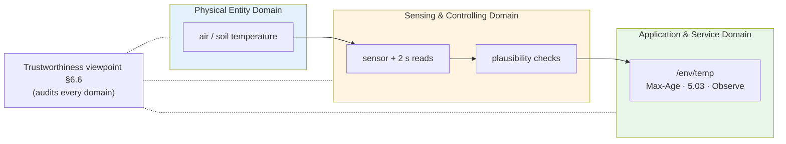

# Lab 4: Real Sensors — Can You Trust the Reading?

**GreenField Technologies — SoilSense Project** · Phase: Network design · 3 hours

**From:** Edwin (Field Operations)
**Subject:** The north plot, Tuesday

> On Tuesday the dashboard showed 24 °C at the north plot all afternoon. The probe had
> been pulled out of its socket in the morning; the node kept answering with the last
> value it had. Nobody could tell a quiet afternoon from a dead sensor.
>
> Daniela also asks why the new node reads two degrees above her thermometer, and which
> one she should believe.
>
> Before we put real sensors in the field I need to know when to trust a number, and when
> a missing number means "send someone to fix the sensor" versus "the node is down".
>
> — Edwin

| Stakeholder | Their question | How this lab answers |
|---|---|---|
| **Daniela (farmer)** | Is the number right? | Part 3: resolution, noise, offset and response of a real sensor, and checks that reject impossible values. |
| **Edwin (Ops)** | Is it the sensor or the node? | Part 4: the two failures look different to a client, and you time both. |
| **Samuel (architect)** | What does `/env/temp` promise now? | Part 2: the contract gains accuracy and freshness. |
| **ISO 30141 auditor** | Is the system trustworthy? | Your first Trustworthiness audit (DDR §9), with evidence from Parts 3–5. |
| **Edward (Security)** | Can someone feed it fake readings? | Not today: Part 3 shows why plausibility checks can't stop that. Lab 6 can. |

Unfamiliar terms are in the [glossary](../glossary.md). The firmware, the wiring and
extra experiments are in [SOP-04](sops/sop04_sensor_integration.md).

---

## Background: trustworthiness, a new lens

Labs 1–3 placed each piece of SoilSense on the Functional viewpoint's map: the radio in
SCD, the CoAP contracts in ASD. ISO/IEC 30141 also has a **Trustworthiness viewpoint**
(§6.6). It isn't a seventh domain: it's a set of questions you ask about every domain,
the way an auditor walks through a building you already built. The standard names seven
characteristics: availability, confidentiality, integrity, reliability, resilience,
safety and compliance.

A real sensor is where four of them stop being abstract:

| Characteristic | The standard's words (§6.6.2.3) | Today's question | Part |
|---|---|---|---|
| **Integrity** | data "not altered by faulty or unauthorized devices, by malicious actors, or by environmental causes" | Is the number right, and how would we know if it weren't? | 3 |
| **Availability** | the device's "network connectivity" and "the ability of the system to get the requested data" | Can a client get a current value? What does it get when it can't? | 4 |
| **Reliability** | "consistent, intended behaviour and results" | How often does a reading fail, and does the radio make it worse? | 5 |
| **Resilience** | continuing "in the presence of faults", "self-monitoring and self-healing" | Does the node recover by itself, and what is lost meanwhile? | 5 |

Today covers the faulty devices and environmental causes. The malicious actors, and
confidentiality, are Lab 6.

---

## Part 1 — Setup

**Per pair:** 2 boards, one sensor, a breadboard and jumper wires. **S** is the field node
with the sensor, **C** is the client, as in Lab 3.

**Task 1.1** — wire your sensor to S. Power it from 3V3, never 5 V: the data line is
pulled up to the sensor's supply, and 5 V on a C6 pin damages it. If S also needs 3V3
for something else, run 3V3 and GND to the breadboard rails first.

| Sensor | Connections | Accuracy (datasheet) |
|---|---|---|
| DS18B20 waterproof probe | red → 3V3, black → GND, yellow → **GPIO18** | ±0.5 °C |
| DHT22 / AM2302 module (white) | VCC → 3V3, GND → GND, DAT → **GPIO19** | ±0.5 °C, ±2 %RH |
| DHT11 module (blue) | VCC → 3V3, GND → GND, DATA → **GPIO19** | ±2 °C, ±5 %RH |
| BMP280 module | VCC → 3V3, GND → GND, SDA → **GPIO6**, SCL → **GPIO7**, CSB → 3V3, SDO → GND | ±1 °C |

**Task 1.2** — flash [`firmware/lab4_sensors`](../../firmware/lab4_sensors). S gets the
overlay for its sensor (`ds18b20`, `dht22`, `dht11` or `bmp280`); C is built without
one:

```bash
source ~/zephyrproject/env.sh
cd firmware/lab4_sensors

# S (example: DHT22)
west build -p always -b esp32c6_devkitc/esp32c6/hpcore . -- \
    -DEXTRA_DTC_OVERLAY_FILE=sensors/dht22.overlay
west flash

# C
west build -p always -b esp32c6_devkitc/esp32c6/hpcore .
west flash
```

Only the overlay differs between the four sensors: the application and its CoAP contract
are the same. That's what the devicetree is for. (Super Mini: add the USB console options
from Lab 1, separating the two overlays with a `;`.)

**Task 1.3** — form the network and start the client exactly as in Lab 3 (Tasks 1.2 and
1.3): C is the leader and runs `ot coap start`; note S's `ot ipaddr mleid`.

**Task 1.4** — check the sensor on S:

```bash
uart:~$ soilsense stats
sensor:    dht22
last good: 24.10 C, 1 s ago
humidity:  70.6 %RH
reads:     7 in 13 s: 0 failed (0.0 %), 0 rejected
read time: min 21543 us, avg 21587 us, max 21597 us
```

S reads the sensor every 2 s. A read that fails, or a value the checks reject, never
replaces the last good reading.

## Part 2 — The contract, now with promises

`/env/temp` keeps the Lab 3 URI, methods, CBOR payload and Observe policy. What's new is
what it promises about the value:

| | |
|---|---|
| **Payload** | `{"t": float16}`, °C (unchanged) |
| **Accuracy** | your sensor's datasheet figure (Task 1.1 table) |
| **Max-Age** | how many more seconds the value stays fresh: 60 s minus the reading's age |
| **Plausibility** | values outside −40 to 85 °C, or more than 5 °C from the previous reading 2 s earlier, are rejected and never served |
| **No fresh reading** | when no accepted reading is younger than 60 s: `5.03 Service Unavailable`, Max-Age 10 (retry after), text payload `no fresh reading` |
| **Observe** | as in Lab 3 while readings are fresh; when they stop being fresh, each observer gets one 5.03 notification (CON) and its observation ends |

```
env-reading = { t: float16 }        ; °C, accuracy per sensor, fresh for Max-Age s
```

Max-Age was in Lab 3's contract already, but with a simulated sensor every value was
current. Now it's a promise: a client may use the value until Max-Age runs out, and the
server never hands out a value older than it promised.

## Part 3 — Integrity: is the number right?

**Task 3.1** — resolution and noise. Leave the sensor alone, turn on the per-reading log
for one minute, then turn it off:

```bash
uart:~$ soilsense log on
<inf> reading: dht22: 24.10 C, 70.6 %RH
...
uart:~$ soilsense log off
```

Record the smallest step between two readings (resolution) and the spread over the
minute (noise).

**Task 3.2** — offset. Compare your reading with the reference the instructor posts (a
DS18B20 or a thermometer in the same spot). Is the difference inside your sensor's
accuracy?

**Task 3.3** — response. On C, observe `/env/temp` (Lab 3 Task 3.2). Breathe on the
sensor for 3–5 s, then let it recover. From S's log, record the rise, the time to reach
half of it, and how many notifications went out. Then compare with a pair that has a
different sensor: the bare chip and the steel probe give very different curves for the
same breath.

DHT pairs: watch the humidity in `soilsense stats` as well. Breath is close to 100 %RH;
the reading pins at the top of the sensor's range (95 % on a DHT11, 100 % on a DHT22)
and takes minutes to come down as the element dries. A value stuck at the limit of the
range is not a measurement.

**Task 3.4** — the plausibility checks. Feed S made-up readings, as a faulty sensor
might:

```bash
uart:~$ soilsense inject 90
<wrn> reading: Rejected 90.00 C from inject: outside -40..85 C
uart:~$ soilsense inject 31.5
<wrn> reading: Rejected 31.50 C from inject: jumped +7.4 C in one sample
uart:~$ soilsense inject 25.5
```

The last one passes: it is wrong, but believable. Write down why no check on a single
node can catch it, and what could.

## Part 4 — Availability: can the client get the data?

Keep C observing `/env/temp` throughout.

**Task 4.1** — the sensor dies. Pull the sensor's data wire out of S and start a stopwatch.

1. S logs three failed reads, then `Sensor lost`. Notifications continue (heartbeats,
   with the last good value).
2. Every 15 s, run `ot coap get <S-mleid> env/temp` on C. In S's log, follow the
   reading's age and the Max-Age it was served with.
3. About 60 s after the last good reading, S logs `GET now answers 5.03` and ends the
   observation. Record what C prints, and what a GET returns now. The shell prints only
   payloads: decode the hex as ASCII, and read the response code in S's log.

**Task 4.2** — the node dies. Plug the data wire back in, wait for `Sensor back`, and
register the observation again on C. Then make S unreachable with `ot thread stop` on S.

1. On C: `ot coap get <S-mleid> env/temp con`, and time the `ResponseTimeout`.
2. What does C's observation print while S is gone?
3. `ot thread start` on S when you're done.

| Failure | What C receives | Time until C can tell |
|---|---|---|
| Sensor unplugged, node up | | |
| Node off the network | | |

## Part 5 — Reliability and resilience

**Task 5.1** — failure rate, quiet versus busy. On S, `soilsense reset`, wait 2 minutes,
and record `soilsense stats` (quiet). Reset again and keep S's radio busy for 2 minutes
with pings from C (10 per second):

```bash
uart:~$ ot ping <S-mleid> 64 1200 0.1
```

Record the stats again (busy). Compare the two failure rates, then compare with pairs
using other sensors.

**Task 5.2** — self-healing. From Task 4.1: how long after you plugged the wire back in
did S log `Sensor back`, and when did GET answer 2.05 again? Did C's observation resume
by itself?

**Task 5.3** — reboot. Press S's reset button. After it restarts, what's still there
(network, readings, counters, C's observation), and who has to act to restore each one?
If S logs `... was not found at boot`, the driver only looks for that sensor when the
board starts: fix the wiring and reset again.

## Part 6 — The class table

Add your row to the shared table. Your DDR cites the whole table, not just your row.

| Sensor | Resolution | Noise (1 min) | Offset vs reference | Breath: rise / half-rise time | Notifications in Task 3.3 | Read time | Failures quiet / busy | Recovers by itself? |
|---|---|---|---|---|---|---|---|---|
| | | | | | | | | |

## Part 7 — The "why" questions (DDR Section 5)

1. **Why does `/env/temp` answer 5.03 instead of the last value it has?** What does Max-Age
   promise, and what would a stale value presented as current do to Daniela's decisions?
2. **How does a client tell "sensor dead" from "node unreachable"?** Which of the two
   needs an answer from the node, and which shows up only as silence?
3. **Why can't a plausibility check stop a value that is wrong but believable?** What
   would: a second sensor, a neighbour's reading, a signature (Lab 6)?
4. **Why can a busy radio make a sensor read fail?** Compare a sensor whose protocol the
   CPU times bit by bit with one that has its own bus hardware.

## ISO/IEC 30141 mapping

The physical entity (air or soil temperature) is in the **PED**; the sensor, its reads and
the plausibility checks are **SCD** sensing; the `/env/temp` contract, now with freshness
and the 5.03 rule, is **ASD**. Trustworthiness isn't a box on this map: it's the audit
laid over all three.



## Deliverables

1. **DDR update:**
   - Section 4: the updated `/env/temp` contract (accuracy, freshness, 5.03) as an ASD
     entry; your sensor and its checks as SCD; the measured quantity as PED.
   - Section 5: the "why" answers.
   - Section 6: time until a client sees a lost sensor (target ≤ 60 s) and the read
     failure rate with the radio busy (target < 5 %).
   - Section 8: the Trustworthiness row, Labs Addressed = "Lab 4".
   - Section 9, **Trustworthiness audit, first fill-in**: availability, integrity,
     reliability and resilience, each with the evidence from Parts 3–5 and the gaps that
     remain. Mark confidentiality and integrity against malicious actors "→ Lab 6".
2. **Safety design** (DDR Section 7 and the §9 safety row): an irrigation rule uses
   `/env/temp`. What should it do when it gets a 5.03, or no answer at all? Name the
   default and how long it waits before applying it.
3. **Summary for Edwin** (three lines): how his crew tells a dead sensor from a dead node,
   and how long each takes to show up.

## Grading (100 pts)

| | pts |
|---|---|
| **Technical execution** — sensor wired and read (5) · resolution, noise, offset, response (10) · both failure modes timed (10) · quiet vs busy failure rate and recovery (10) · class-table row (5) | 40 |
| **ISO/IEC 30141** — §9 audit, four rows with evidence and gaps (15) · updated contract (10) · PED / SCD / ASD placement (5) | 30 |
| **First principles** — Q1 (5) · Q2 (5) · Q3 (5) · Q4 (5) | 20 |
| **Communication** — Edwin summary (5) · class-table comparison used in the DDR (5) | 10 |
| **Ethics (pass/fail)** — safety default for missing data; the contract states the sensor's real accuracy, not a better one | ✓ |

## Resources & next week

ISO/IEC 30141:2024 §6.6 (Trustworthiness) · RFC 7252 §5.9.3.4 (5.03) and §5.10.5
(Max-Age) · RFC 7641 §4.2 (an error notification ends the observation) · your sensor's datasheet

**Lab 5:** the mesh gets a Border Router, and "can the client reach the data?" stretches
from one hop to the Internet.
