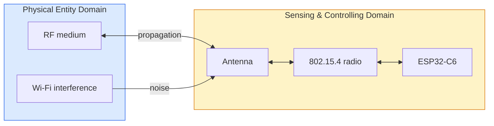

# Lab 1: The Radio — Channel, Range and Packet Loss
> - **Talk:** [01_radio.md](../presentations/01_radio.md) · **SOP:** [SOP-01: Radio bring-up and link measurements](sops/sop01_radio.md)
> - **Reading:** [theory_foundations.md](../docs/theory_foundations.md) §1 (O-QPSK, link budget, CSMA-CA)

**GreenField Technologies — SoilSense Project** · Phase: Feasibility · 2–3 hours

**From:** Samuel (Senior Architect) — *"Hardware picked the ESP32-C6 for its cost and its
Thread support. Before we commit, I want field data, not vendor specs: how far apart two
nodes can sit and still deliver 99 % of their packets, which channel is cleanest here, and
which RSSI tells us a link is safe. Put it in the DDR, with PED and SCD mapped."*

Today two boards go on the air for the first time. You pick the channel with the least
interference, then walk the boards apart and measure how signal strength and packet loss
change with distance. Everything the mesh does from Lab 2 on stands on these numbers.

| Stakeholder | Their question | How this lab answers |
|---|---|---|
| **Samuel (architect)** | Which RSSI predicts 99 % delivery, and at what range? | Task D: RSSI and packet loss against distance. |
| **Gustavo (product)** | How many nodes does a 10-hectare field need? | Your reliable range sets the spacing; the spacing sets the cost. |
| **Edwin (Ops)** | Which channel, and what do I check when packets go missing? | Task B: the energy scan behind ADR-001. |
| **ISO 30141 auditor** | Where does the device end and the physical world begin? | The PED/SCD map and the capabilities table. |

Unfamiliar terms (RSSI, PER, dBm, link budget) are in the [glossary](../docs/glossary.md).

## What you'll measure

Hand in the prediction column before the lab. Every board in the room uses the TX power
your instructor announces, so tables can be compared.

| Quantity | Prediction | Your value | Target |
|---|---|---|---|
| Noise floor, quietest channel | ____ | ____ dBm | — |
| Noise floor, loudest channel | ____ | ____ dBm | — |
| RSSI at 1 m | ____ | ____ dBm | — |
| RSSI drop per doubling of distance | ____ | ____ dB | free space: 6 dB |
| RSSI below which PER exceeds 1 % | ____ | ____ dBm | — |
| Maximum reliable range (PER < 1 %) | ____ | ____ m | > 20 m |

## Tasks

**Per pair:** 2 ESP32-C6 boards (DevKitC-1, DevKitM-1 or Super Mini), 2 USB-C cables,
a 50 m measuring tape. One partner owns **A**, the other **B**; each laptop runs its own
monitor.

### Task A — Bring up both boards
- Flash [`firmware/lab1_radio`](../firmware/lab1_radio) to both boards and open the shell
  ([SOP-01 §1](sops/sop01_radio.md#1-build-and-flash)). It is Zephyr's OpenThread
  shell with auto-start off: the radio stays silent until you start it.
- **Evidence:** `ot extaddr` of each board: these are your board IDs for every table
  in the DDR.

### Task B — Find the quietest channel
- Energy-scan all 16 channels ([SOP-01 §2](sops/sop01_radio.md#2-scan-the-channels)).
  Lower (more negative) means quieter.
- Mark on your scan which 802.15.4 channels sit under Wi-Fi channels 1, 6 and 11, and
  which fall in the gaps between them. Does your loudest channel line up with a Wi-Fi
  network you can see from your phone?
- **Evidence:** the scan, annotated with the Wi-Fi overlap, and the channel you choose.

### Task C — Form a two-board link
- Set the announced TX power on both boards, form a network on your channel with A as
  the leader, and join B with A's dataset
  ([SOP-01 §3](sops/sop01_radio.md#3-form-a-two-board-network)). Wait until B is a
  `router`: the neighbor table you read in Task D lists routers on both sides.
- Ping in both directions at close range.
- **Evidence:** `ot state` on both boards and A's `ot neighbor table`.

### Task D — RSSI and packet loss against distance
- At 1, 5, 10, 20, 30 m and beyond: A sends 100 pings of 64 bytes to B, **then** B to A,
  never both at once; then both read `ot neighbor table`
  ([SOP-01 §4](sops/sop01_radio.md#4-measure-rssi-and-packet-loss)). RSSI is measured by
  the receiver, so A's table shows the B→A signal.
- Keep the payload size and the TX power fixed, and stop once PER passes 10 %.

  | Distance (m) | RSSI A→B (dBm) | RSSI B→A (dBm) | PER A→B | PER B→A |
  |---|---|---|---|---|
  | 1 | ____ | ____ | ____ | ____ |
  | 5 | ____ | ____ | ____ | ____ |
  | 10 | ____ | ____ | ____ | ____ |
  | … | ____ | ____ | ____ | ____ |

- Find the RSSI at which PER first exceeds 1 %, and the distance where you crossed it:
  that is your maximum reliable range. If A→B and B→A differ by more than 10 dB, look
  for a hand or a laptop over one antenna before you trust the row.
- **Evidence:** the table, with the ping summary line for each row, and a plot of RSSI
  against log₁₀(distance).

### Task E (optional) — The losses you never see
- Every unicast frame asks for an ACK and is retransmitted until one arrives. Unplug B,
  send A one ping, and count the retransmissions in A's MAC counters; repeat with the
  802.15.4 default of 3 retries ([SOP-01 §5](sops/sop01_radio.md#5-mac-counters-and-retries)).
  Your Task D PER was measured with 15 retries: what was the real frame loss at your
  edge distance?
- At 1 m, ping in both directions at once on purpose, and compare RTT, `TxRetry`,
  `TxErrCca` and PER with the sequential run. CCA found the channel clear, yet frames
  collided: how?
- With a third board in promiscuous mode, decode one frame's header
  ([SOP-01 §6](sops/sop01_radio.md#6-sniff-the-channel)).
- **Evidence:** the counter readings for each run, and one decoded frame.

## ISO/IEC 30141 mapping

You tested the **PED** (radio waves, interference) through the **SCD** (radio, antenna,
MCU). The antenna is the boundary: it turns SCD bits into PED waves and back. The standard
calls this link **proximity networking**; all six domains are in
[iso_architecture.md](../docs/iso_architecture.md).

ISO/IEC 30141 §9 (Tables 9–10) classifies what a component *can* do. Decompose your
board; for each row, say whether the capability is active or latent today, and why:

| Category | Capability on your board | Active / latent? |
|---|---|---|
| Transducer | on-board LED (actuating) | ____ |
| Data | 802.15.4 TX/RX · NVS storage | ____ |
| Interface | 802.15.4 network · OpenThread shell | ____ |
| Supporting | time sync · hardware crypto | ____ |
| Other radios | BLE · Wi-Fi · USB | ____ |

This table grows as later labs switch capabilities on.

## Deliverables

Update [your DDR](../docs/ddr_template.md):

- **§1 System overview:** the two boards and their IDs.
- **§2 Lab log:** *To Samuel*: reliability threshold and recommended spacing, with a
  margin for vegetation. *To Gustavo*: nodes for a 10-hectare field at that spacing, at
  $40 a node, and a verdict (proceed, test more, or switch). *To Edwin*: a field card for
  "won't join" and "intermittent loss".
- **§3 ADR-001, channel selection:** the channel, its noise floor, and the Wi-Fi
  networks it avoids.
- **§4 ISO mapping:** the PED/SCD table and the capabilities table.
- **§5 First principles:**
  1. Why does RSSI drop with distance, and by how much per doubling?
  2. The receiver decodes signals near −100 dBm. Why did you need a much stronger
     signal for PER < 1 %? Where do the missing decibels go?
  3. *(Optional)* How does an 802.15.4 link survive Wi-Fi on the same band?
- **§6 Performance:** the row "Lab 1: Max Range" (> 20 m), with the distance table.
- **§7 Ethics:** passive scanning only, and radios off when not testing.

## Grading (100 pts)

| | pts |
|---|---|
| **Technical execution** — channel scan with Wi-Fi overlap (10) · RSSI and PER table (15) · threshold and range from the data (10) · predictions handed in (5) | 40 |
| **ISO/IEC 30141** — PED/SCD mapping (10) · capabilities table with reasons (10) · ADR-001 format (10) | 30 |
| **First principles** — Q1 (10) · Q2 (10) | 20 |
| **Communication** — Samuel, Gustavo and Edwin entries (10) | 10 |
| **Ethics (pass/fail)** — passive scanning only (no jamming); radios off when not testing | ✓ |

## Resources & next week

[Zephyr OpenThread shell sample](https://docs.zephyrproject.org/latest/samples/net/openthread/shell/README.html) ·
[OpenThread CLI reference](https://openthread.io/reference/cli/commands) ·
IEEE 802.15.4-2020, Clauses 6 (MAC) and 8 (PHY) ·
[references.md](../docs/references.md)

**Lab 2:** Edwin's tractor flattens a node. Can the others route around it? Samuel's
question for the talk: *"How do we fit IPv6 into a 127-byte frame?"* Skim RFC 6282.
