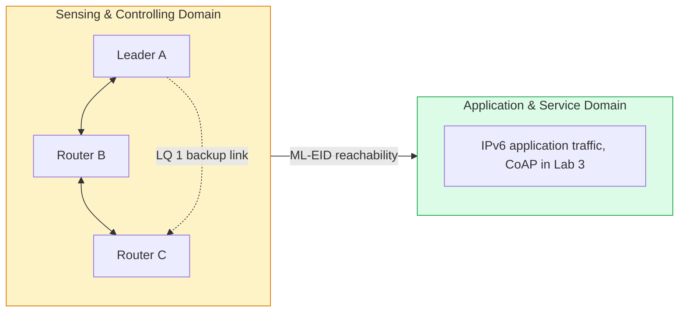

# Lab 2: Thread Mesh — Addresses, Hops and Self-Healing
> - **Talk:** [02_mesh.md](../presentations/02_mesh.md) · **SOP:** [SOP-02: Mesh bring-up and routing experiments](sops/sop02_mesh.md)
> - **Reading:** [theory_foundations.md](../docs/theory_foundations.md) §2–§3 (6LoWPAN, mesh routing)

**GreenField Technologies — SoilSense Project** · Phase: Core connectivity · 2–3 hours

**From:** Edwin (Field Operations Lead) — *"A pilot farmer drove a tractor over a node,
and everything that relied on it went dark. We can't depend on any single node, so we're
going with Thread: every router forwards for its neighbours. I need three answers. Can a
node out of range reach the gateway through others? If a router dies, does the network
heal in under 2 minutes? And what does each extra hop cost the valves?"*

Today three boards form a Thread mesh. You sort out the addresses every node carries,
force a two-hop path on a desk, measure what the extra hop costs, and then kill the
router in the middle while traffic flows.

| Stakeholder | Their question | How this lab answers |
|---|---|---|
| **Edwin (Ops)** | If a node is crushed, does the network survive? | Task E: you unplug a router mid-ping and time the recovery. |
| **Samuel (architect)** | What does a hop cost, and which address should our apps use? | Task C classifies the addresses; Task D measures 1 and 2 hops. |
| **ISO 30141 auditor** | How do devices reach each other inside the sensing domain? | The SCD's proximity network becomes a routed mesh. |

Unfamiliar terms (RLOC, ML-EID, REED, link quality) are in the [glossary](../docs/glossary.md).

## What you'll measure

Hand in the prediction column before the lab.

| Quantity | Prediction | Your value | Target |
|---|---|---|---|
| RTT A → B, 1 hop (avg of 20) | ____ | ____ ms | — |
| RTT A → C, 2 hops through B (avg of 20) | ____ | ____ ms | — |
| Cost of the extra hop | ____ | ____ ms | — |
| Frames B sends while A pings C 20 times | ____ | ____ | — |
| Healing time after the relay dies (3 runs) | ____ | ____ s | < 120 s |

## Tasks

**Per group:** 3 ESP32-C6 boards (any mix of DevKitC-1, DevKitM-1 and Super Mini), one
laptop and monitor per board. Team up with another pair. Call the boards **A**, **B**
and **C**.

### Task A — Bring up three boards
- Flash [`firmware/lab2_mesh`](../firmware/lab2_mesh) to all three and wipe the Lab 1
  dataset ([SOP-02 §1](sops/sop02_mesh.md#1-build-and-flash)). It is the Lab 1 firmware
  plus MAC filtering, for Task D, and an RGB LED that shows each board's Thread role.
- **Evidence:** `ot extaddr` of each board.

### Task B — Form the mesh
- Form one network with A as the leader and join B and C with A's dataset
  ([SOP-02 §2](sops/sop02_mesh.md#2-form-the-mesh)). Wait for all three LEDs to settle.
- Read `ot router table` on A. Which column says whether A reaches a router directly,
  and what do Next Hop and Path Cost describe?
- **Evidence:** A's router table with B and C as routers.

### Task C — Who is who: Thread addresses
- List every unicast and multicast address on each board
  ([SOP-02 §3](sops/sop02_mesh.md#3-list-the-addresses)). Classify each unicast address
  as link-local, RLOC, ALOC or ML-EID: its scope, and what it is used for.
- Derive two of them by hand. The link-local interface ID is the extended MAC address
  with one bit flipped: which bit, in which byte? The RLOC16's top 6 bits are the router
  ID: check yours against `ot router table`.
- Which multicast groups disappear when a node is a child instead of a router?
- **Evidence:** each board's address list, annotated.

### Task D — Two hops on a desk
- Three boards on one desk all hear each other. Make the A–C link poor on purpose, so
  that A reaches C through B ([SOP-02 §4](sops/sop02_mesh.md#4-force-a-two-hop-path)).
  Compare the costs of the direct link and the path through B in A's router table.
- Prove the packets really cross B: count B's transmitted frames while A pings C, once
  before the filters and once after.
- Measure 20 pings of 64 bytes by ML-EID to B (1 hop) and to C (2 hops), one at a time.

  | Path | Hops | RTT min / avg / max (ms) | Loss |
  |---|---|---|---|
  | A → B | 1 | ____ | ____ |
  | A → C | 2 | ____ | ____ |
  | Lab 1, A → B | 1 | ____ | ____ |

- **Evidence:** A's router table with the filters on, B's counters before and after, and
  the RTT table.

### Task E — The tractor test
- B is now the only good path between A and C. A pings C once a second; after about ten
  replies, **unplug B** and note the time ([SOP-02 §5](sops/sop02_mesh.md#5-the-tractor-test)).
  Never unplug A: losing the leader is a different experiment (Task F).
- Each missing reply is about one second of outage. After the run, read A's router
  table: how does A reach C now?
- Plug B back in, restart it, wait until A routes through B again, and repeat twice.

  | Run | Pings lost | Healing time (s) | Route after |
  |---|---|---|---|
  | 1 | ____ | ____ | ____ |
  | 2 | ____ | ____ | ____ |
  | 3 | ____ | ____ | ____ |

- **Evidence:** the three ping summaries, the table, and A's router table after a run.

### Task F (optional) — Fragments and a dead leader
- Find the largest ping that still fits in one 802.15.4 frame, toward B's ML-EID, B's
  RLOC and C over two hops ([SOP-02 §6](sops/sop02_mesh.md#6-count-fragments)). Build the
  byte budget for that size: 127 bytes minus which headers?
- Unplug the leader while B pings C, and time the events: when do the pings fail, when
  is a new leader elected, when does the partition ID change, and which partition wins
  when A returns ([SOP-02 §7](sops/sop02_mesh.md#7-kill-the-leader))? Why do the routers
  wait instead of electing a new leader at once?
- **Evidence:** the size table and the leader-loss timeline.

## ISO/IEC 30141 mapping

The mesh lives in the **SCD**: routers, links and MLE are its communication subsystem.
Stable ML-EIDs are what lets **ASD** services address individual nodes from Lab 3 on.

In the **Functional viewpoint**, map each Thread role to its function and its power
profile: leader, router, REED, end device and sleepy end device. Routers keep their
receiver on all the time: what does that mean for Lab 1's 3-month battery target?

## Deliverables

Update [your DDR](../docs/ddr_template.md):

- **§2 Lab log:** *To Edwin*: healing time, whether it meets 2 minutes, and what a field
  tech checks when a node goes dark. *To Samuel*: the cost per hop, the address type the
  firmware must use, and why.
- **§3 ADR-002, topology:** Thread mesh against a LoRaWAN-style star for this field, with
  your RTT and healing numbers as evidence.
- **§4 ISO mapping:** the address classification and the Thread-role mapping.
- **§5 First principles:**
  1. How does a 40-byte IPv6 header fit in a 127-byte frame? Which interface ID can the
     receiver rebuild from the MAC header, the RLOC's or the ML-EID's?
  2. Why did healing take seconds and not minutes? What told A that B was gone, and what
     would happen on a link that carried no traffic?
  3. Why does Task E need a *poor* A–C link instead of *no* link? What does that mean
     for node spacing in Daniela's field?
  4. *(Optional)* Why do applications use the ML-EID? Ping C by its RLOC, make C attach
     somewhere else, and see what happens to the old RLOC.
- **§6 Performance:** the row "Lab 2: Healing Time" (< 120 s), with the three runs.
- **§7 Ethics:** your own network only (random dataset); radios off after testing.

## Grading (100 pts)

| | pts |
|---|---|
| **Technical execution** — 3-router mesh formed (5) · address classification with derivations (10) · 1- vs 2-hop RTT with relay proof (10) · three tractor runs with healing times (15) | 40 |
| **ISO/IEC 30141** — Thread roles in the Functional viewpoint (15) · SCD/ASD mapping (10) · ADR-002 format (5) | 30 |
| **First principles** — Q1 (7) · Q2 (7) · Q3 (6) | 20 |
| **Communication** — Edwin entry (5) · Samuel entry (5) | 10 |
| **Ethics (pass/fail)** — your own network only; radios off after testing | ✓ |

## Resources & next week

[Thread primer: IPv6 addressing](https://openthread.io/guides/thread-primer/ipv6-addressing) ·
[Thread primer: router selection](https://openthread.io/guides/thread-primer/router-selection) ·
RFC 6282 (6LoWPAN header compression) ·
[OpenThread CLI reference](https://openthread.io/reference/cli/commands)

**Lab 3:** the mesh routes IPv6. Samuel's next question: *"How do applications talk over
it, and why not just use HTTP?"*
