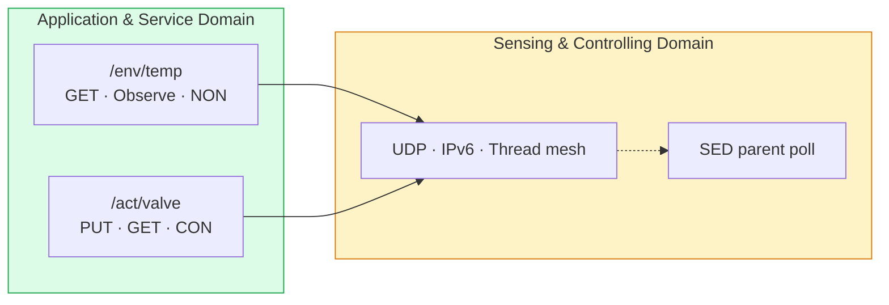

# Lab 3: CoAP — Reading Sensors and Commanding Valves
> - **Talk:** [03_coap.md](../presentations/03_coap.md) · **SOP:** [SOP-03: CoAP client, server and dashboard](sops/sop03_coap.md)
> - **Reading:** [theory_foundations.md](../docs/theory_foundations.md) §4 (CoAP)

**GreenField Technologies — SoilSense Project** · Phase: Application layer · 3 hours

**From:** Daniela (pilot farmer), forwarded by Edwin (Field Operations) — *"The Wi-Fi
prototype's batteries died in four days, and the dashboard takes forever to update. And
the 'open valve' command went out at 06:00: the valve didn't move until 06:14, and nobody
could tell me whether it had received the command at all."*

The mesh from Lab 2 works. Today you put the application on top: readings that cost one
small datagram and arrive when the value changes, and valve commands that are
acknowledged or fail loudly, even when the valve sleeps.

| Stakeholder | Their question | How this lab answers |
|---|---|---|
| **Daniela (farmer)** | Why do batteries die, and why is the dashboard stale? | Tasks B–C: one datagram per reading, pushed on change with Observe. |
| **Edwin (Ops)** | How do I command a valve and *know* it moved? | Task D: CON requests are acknowledged or retried, and fail loudly. |
| **Samuel (architect)** | Which delivery mode for which message, and what does a sleeping valve cost? | Tasks D–E: CON vs NON, and latency against poll period. |
| **ISO 30141 auditor** | Are the data interfaces documented? | Two published API contracts, cited in the DDR. |

Unfamiliar terms (CON, NON, Observe, CBOR, Content-Format) are in the
[glossary](../docs/glossary.md).

## What you'll measure

Hand in the prediction column before the lab.

| Quantity | Prediction | Your value | Target |
|---|---|---|---|
| Ping round trip C → S, 1 hop (avg of 10) | ____ | ____ ms | — |
| GET `/env/temp` round trip C → S (median of 10) | ____ | ____ ms | < 200 ms |
| GET `/env/temp`: request / response size | ____ | ____ B | one 802.15.4 frame each |
| Observe notifications in 5 min, against 300 GETs at 1 Hz | ____ | ____ | — |
| CON PUT to a valve that left: time to `ResponseTimeout` | ____ | ____ s | — |
| Downlink round trip to a sleepy valve, poll period 5 s | ____ | ____ ms | < 5 s |
| PUTs received twice by a sleepy valve (out of 5) | ____ | ____ | — |

## Tasks

**Per pair:** 2 boards. **S** is the field node (a simulated temperature sensor and a
valve), **C** is the client standing in for the gateway. S serves the two contracts of
the [SoilSense API](../docs/api.md), which your ADRs and DDR §4 cite.

### Task A — Bring up S and C
- Flash [`firmware/lab3_coap`](../firmware/lab3_coap) to both boards and form the network
  with **C as the leader**, since Task E makes S a sleepy child of C. Start the CoAP client
  on C only ([SOP-03 §1](sops/sop03_coap.md#1-build-flash-and-form-the-network)).
- **Evidence:** `ot state` on both boards and S's ML-EID.

### Task B — Uplink: a reading in one datagram
- GET `/env/temp` once from C ([SOP-03 §3](sops/sop03_coap.md#3-get-and-time-it)).
  Decode the 6 payload bytes by hand against the
  [contract](../docs/api.md#envtemp--air-temperature), then check them at
  [cbor.me](https://cbor.me).
- Time 10 GETs and 10 pings from C to S. What does the CoAP server add to the round trip?
- From S's log, fill in the byte budget. Add UDP (8 B) and the compressed IPv6 header
  (Lab 2): does every message fit in one 802.15.4 frame?

  | Exchange | Request | Response | Packets |
  |---|---|---|---|
  | HTTP/JSON reading (Lab 0) | ~150 B + TCP | ~120 B + TCP | 7+ |
  | MQTT/JSON reading (Lab 0) | — | ~40 B + TCP | 1, on a kept-open connection |
  | CoAP GET `/env/temp` | ____ B | ____ B | 2 |
  | CoAP Observe notification | — | ____ B | 1 |
  | CoAP PUT `/act/valve` (CON) | ____ B | ____ B | 2 |

- **Evidence:** the decoded bytes, both RTT summaries, S's log lines with the sizes, and
  the table.

### Task C — Observe instead of polling
- Register for `/env/temp` for 5 minutes, then cancel
  ([SOP-03 §4](sops/sop03_coap.md#4-observe)). S logs each notification with its reason.
  The simulated sensor swings ±1 °C over 60 s.

  | Window | Threshold notifications | Heartbeats | GETs a 1 Hz poller sends | Ratio |
  |---|---|---|---|---|
  | 5 min | ____ | ____ | 300 | ____ |

- **Evidence:** S's notification log and the table.

### Task D — Downlink: commands with proof
- Open and close the valve with CON PUTs, and read it back with GET; S's LED turns white
  while the valve is open ([SOP-03 §5](sops/sop03_coap.md#5-command-the-valve)). Send the
  same PUT twice, then a bad payload: what does S log each time?
- Make S leave the network, send a CON PUT and time how long C takes to give up. Repeat
  with a NON PUT and wait two minutes. Predict the CON timeout first from RFC 7252 §4.8:
  the first wait is random in 2–3 s and doubles after each of the 4 retransmissions.
- **Evidence:** S's log for the repeated PUT and the bad payload, the measured CON timeout
  against your prediction, and what C printed for the NON PUT.

### Task E — A valve that sleeps
- Make S a sleepy end device polling its parent every second
  ([SOP-03 §6](sops/sop03_coap.md#6-make-s-sleep)). Ping it from C at three poll periods.

  | Poll period | RTT min / avg / max (ms) | Radio-on fraction for polling (estimate) |
  |---|---|---|
  | 1 s | ____ | ____ |
  | 5 s | ____ | ____ |
  | 15 s | ____ | ____ |

- At a 5 s poll period, send five PUTs about 15 s apart. For each, note how long C waited
  and how many times S logged the PUT. Which arrived twice, and why? Compare CoAP's first
  retransmission time with the poll period. Restore S when you're done.
- **Evidence:** both tables and S's log for the duplicated PUTs.

### Task F — Daniela's dashboard
- With S awake again, run `tools/dashboard_coap.py` on C's serial port
  ([SOP-03 §7](sops/sop03_coap.md#7-run-the-dashboard)). It is the Lab 0 dashboard,
  now fed by Observe notifications and driving the valve with CON PUTs.
- Open and close the valve from the browser. Same page as Lab 0: what changed underneath?
- **Evidence:** a screenshot with the chart and the valve state, and S's log line for the
  PUT it sent.

### Task G (optional) — Discover, tune, extend
- Ask S what it offers at `/.well-known/core`, and decode the answer.
- Retune C's CON timers so the sleepy valve of Task E stops receiving duplicates. What
  does that cost when the valve really is gone?
- Add `/env/hum` (simulated humidity, CBOR `{"h": uint}` in %): write its contract and
  CDDL first, then the code ([SOP-03 §8](sops/sop03_coap.md#8-extensions)).
- **Evidence:** the decoded link format, the new timeout, or the new contract with a GET.

## ISO/IEC 30141 mapping

Mostly **ASD**: the URIs, methods, CBOR contracts and the Observe and CON interaction
patterns are the service the rest of the system consumes. The mesh and UDP underneath
stay in the **SCD**, and so does the SED parent poll: it belongs to the device's
communication subsystem, not to the application.

CoAP sits on the **functional plane**; Thread MLE (Lab 2) keeps the mesh and the SED's
parent link alive on the **management plane**.

## Deliverables

Update [your DDR](../docs/ddr_template.md):

- **§2 Lab log:** *To Daniela*: why the readings now cost less battery and arrive when
  they change. *To Edwin*: how a command is confirmed, what happens when the valve is
  unreachable, and the latency his crew should expect.
- **§3 ADR-003** (CoAP and CBOR for uplink and downlink, citing Task B's byte budget and
  why MQTT wasn't chosen for the radio side) and **ADR-004** (the poll period for battery
  valves, citing Task E and your energy estimate).
- **§4 ISO mapping:** both API contracts and the CDDL as ASD entries.
- **§5 First principles:**
  1. Why can CoAP use UDP where HTTP needs TCP? What does CON give back, and what does
     NON deliberately give up?
  2. Why does Observe save battery compared with a GET every 60 s? Who knows when the
     value changed, and who pays for the radio?
  3. Why did the sleepy valve receive the same PUT twice, and why was that harmless? What
     would have happened with a "toggle valve" command?
  4. Why CBOR and not a hand-made binary struct?
- **§6 Performance:** the rows "Lab 3: CoAP Latency" (< 200 ms) and "Lab 3: Poll Latency
  (5 s period)" (< 5 s). Add an energy estimate for a sleepy valve: radio RX and sleep
  currents from the ESP32-C6 datasheet (cite the table), about 10 ms of radio per poll,
  and the 2× AA battery life at your chosen poll period.
- **§7 Ethics:** *safety*: the valve receives OPEN, then the network dies before CLOSE.
  What should it do on its own, and after how long?

## Grading (100 pts)

| | pts |
|---|---|
| **Technical execution** — GET decoded against the contract, with RTT (8) · Observe counts and ratio (7) · valve PUT/GET and idempotency (7) · CON timeout and NON comparison (6) · SED latency table (7) · dashboard driving the valve (5) | 40 |
| **ISO/IEC 30141** — both API contracts and CDDL (15) · ASD/SCD split explained (10) · ADR format (5) | 30 |
| **First principles** — Q1 (5) · Q2 (5) · Q3 (5) · Q4 (5) | 20 |
| **Communication** — Daniela and Edwin entries (5) · energy estimate (5) | 10 |
| **Ethics (pass/fail)** — safety design for a lost CLOSE; poll period justified by a stakeholder need | ✓ |

## Resources & next week

RFC 7252 (CoAP) · RFC 7641 (Observe) · RFC 8949 (CBOR) · RFC 8610 (CDDL) ·
[OpenThread CLI: coap](https://openthread.io/reference/cli/commands#coap) ·
[Zephyr CoAP server](https://docs.zephyrproject.org/latest/connectivity/networking/api/coap_server.html)

**Lab 4:** the simulated temperature goes away. You'll read real sensors and serve them
through the same contracts.
