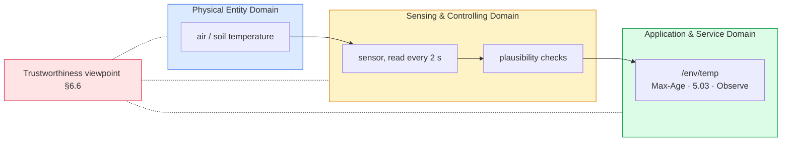

# Lab 4: Real Sensors — Can You Trust the Reading?
> - **Talk:** [04_sensors.md](../presentations/04_sensors.md) · **SOP:** [SOP-04: Sensor wiring, firmware and experiments](sops/sop04_sensors.md)
> - **Reading:** ISO/IEC 30141:2024 §6.6 (Trustworthiness) · your sensor's datasheet

**GreenField Technologies — SoilSense Project** · Phase: Network design · 3 hours

**From:** Edwin (Field Operations) — *"On Tuesday the dashboard showed 24 °C at the north
plot all afternoon. The probe had been pulled out of its socket that morning; the node
kept answering with its last value. Daniela also asks why the new node reads two degrees
above her thermometer. Before real sensors go in the field, I need to know when to trust a
number, and whether a missing one means a dead sensor or a dead node."*

Today a real sensor replaces the simulated temperature behind the same `/env/temp`. You
measure how good it is, then break it on purpose, and record what a client sees when the
sensor fails and when the whole node fails.

| Stakeholder | Their question | How this lab answers |
|---|---|---|
| **Daniela (farmer)** | Is the number right? | Task B: resolution, noise, offset and response of a real sensor, and checks that reject impossible values. |
| **Edwin (Ops)** | Is it the sensor or the node? | Task C: the two failures look different to a client, and you time both. |
| **Samuel (architect)** | What does `/env/temp` promise now? | The contract gains accuracy and freshness. |
| **ISO 30141 auditor** | Is the system trustworthy? | Your first Trustworthiness audit (DDR §9), with evidence from Tasks B–D. |
| **Edward (Security)** | Can someone feed it fake readings? | Not today: Task B shows why plausibility checks can't stop that. Lab 6 can. |

Unfamiliar terms are in the [glossary](../docs/glossary.md).

## What you'll measure

Hand in the prediction column before the lab.

| Quantity | Prediction | Your value | Target |
|---|---|---|---|
| Resolution: the smallest step between two readings | ____ | ____ °C | — |
| Noise: spread over 1 minute, sensor untouched | ____ | ____ °C | — |
| Offset against the reference thermometer | ____ | ____ °C | within the datasheet accuracy |
| Breath test: time to half the rise | ____ | ____ s | — |
| Time until a client sees a lost sensor | ____ | ____ s | ≤ 60 s |
| Time until a client sees a lost node | ____ | ____ s | — |
| Read failure rate, radio quiet / radio busy | ____ | ____ % | < 5 % busy |

## Tasks

**Per pair:** 2 boards, one sensor, a breadboard and jumper wires. **S** is the field node
with the sensor, **C** is the client, as in Lab 3. What `/env/temp` now promises
(accuracy, freshness, the 5.03 rule) is in the [SoilSense API](../docs/api.md#from-lab-4-what-the-value-promises).

### Task A — Wire the sensor and bring up S and C
- Wire your sensor to S from **3V3, never 5 V**, then build S with your sensor's overlay
  and C without one ([SOP-04 §1–2](sops/sop04_sensors.md#1-wire-the-sensor)). Only the
  overlay differs between the four sensors: the application and its contract are the same.
- Form the network and start the client exactly as in Lab 3: C is the leader and runs
  `ot coap start`. Check the sensor with `soilsense stats` on S.
- **Evidence:** a photo of the wiring and `soilsense stats` with reads and 0 failed.

### Task B — Integrity: is the number right?
- **Resolution and noise.** Log every reading for one minute with the sensor untouched
  ([SOP-04 §3](sops/sop04_sensors.md#3-read-log-and-inject)).
- **Offset.** Compare with the reference your instructor posts (a DS18B20 or a
  thermometer in the same spot). Is the difference inside your sensor's accuracy?
- **Response.** With C observing `/env/temp`, breathe on the sensor for 3–5 s and let it
  recover. From S's log, record the rise, the time to half of it, and the notifications
  sent. Compare with a pair that has a different sensor. DHT pairs: watch the humidity
  too. What does a value stuck at the top of the range mean?
- **Plausibility.** Feed S three made-up readings with `soilsense inject`: 90, then 31.5,
  then 25.5. The last one passes: it is wrong, but believable. Why can no check on a single
  node catch it, and what could?
- **Evidence:** the one-minute log, the offset, the breath curve, and the three
  `inject` log lines.

### Task C — Availability: sensor dead or node dead?
- Keep C observing. Pull the sensor's data wire out of S and start a stopwatch. Every
  15 s, GET `/env/temp` from C and follow, in S's log, the reading's age and the Max-Age
  it was served with ([SOP-04 §4](sops/sop04_sensors.md#4-break-the-sensor-and-the-node)).
  Record what C prints when the 5.03 arrives, and what a GET returns afterwards.
- Plug the wire back in, register the observation again, and make S unreachable instead.
  Time C's CON GET until `ResponseTimeout`. What does C's observation print meanwhile?

  | Failure | What C receives | Time until C can tell |
  |---|---|---|
  | Sensor unplugged, node up | ____ | ____ |
  | Node off the network | ____ | ____ |

- Pull the wire once more with the dashboard on C's port instead of the monitor
  ([SOP-03 §7](sops/sop03_coap.md#7-run-the-dashboard)). What does Daniela see, and when?
- **Evidence:** the table, C's output for both failures, and a dashboard screenshot.

### Task D — Reliability and resilience
- **Failure rate.** Reset the counters, wait 2 minutes and record `soilsense stats`
  (quiet). Reset again and keep S's radio busy for 2 minutes with 10 pings a second from
  C (busy). Compare with pairs using other sensors.
- **Self-healing.** From Task C: how long after the wire went back did S log
  `Sensor back`, and when did GET answer 2.05 again? Did C's observation resume by itself?
- **Reboot.** Press S's reset button. What survives (network, readings, counters, C's
  observation), and who has to act to restore each one?
- **Evidence:** both `soilsense stats` outputs and S's log around the recovery and the
  reboot.

### Task E — The class table
- Add your row to the shared table. Your DDR cites the whole table, not just your row.

  | Sensor | Resolution | Noise (1 min) | Offset | Breath: rise / half-rise time | Notifications | Read time | Failures quiet / busy | Recovers by itself? |
  |---|---|---|---|---|---|---|---|---|
  | ____ | ____ | ____ | ____ | ____ | ____ | ____ | ____ | ____ |

- **Evidence:** your row in the class table.

### Task F (optional) — What a read costs
- Compare the read time and CPU use of your sensor with the others, rebuild a DHT with
  interrupts locked during the read, or serve humidity as `/env/hum`
  ([SOP-04 §5](sops/sop04_sensors.md#5-extensions)). Which costs more energy per hour,
  the read every 2 s or one Observe notification?
- **Evidence:** the stats before and after, or the new contract with a GET.

## ISO/IEC 30141 mapping

The physical quantity (air or soil temperature) is in the **PED**; the sensor, its reads
and the plausibility checks are **SCD** sensing; the `/env/temp` contract, now with
freshness and the 5.03 rule, is **ASD**. **Trustworthiness** (§6.6) is not a seventh
domain: it is a viewpoint, an audit laid over all three. Today covers four of its
characteristics: integrity (Task B), availability (Task C), reliability and resilience
(Task D).

## Deliverables

Update [your DDR](../docs/ddr_template.md):

- **§2 Lab log, *To Edwin*:** how his crew tells a dead sensor from a dead node, and how
  long each takes to show up.
- **§4 ISO mapping:** the updated `/env/temp` contract as an ASD entry, your sensor and its
  checks as SCD, the measured quantity as PED.
- **§5 First principles:**
  1. Why does `/env/temp` answer 5.03 instead of the last value it has? What would a stale
     value presented as current do to Daniela's decisions?
  2. How does a client tell "sensor dead" from "node unreachable"? Which one needs an
     answer from the node, and which shows up only as silence?
  3. Why can't a plausibility check stop a value that is wrong but believable?
  4. Why can a busy radio make a sensor read fail? Compare a sensor whose protocol the
     CPU times bit by bit with one that has its own bus hardware.
- **§6 Performance:** the rows "Lab 4: Time to see a lost sensor" (≤ 60 s) and "Lab 4:
  Read failures, radio busy" (< 5 %).
- **§7 Ethics and §9 safety row:** an irrigation rule uses `/env/temp`. What should it do
  on a 5.03, or on no answer at all? Name the default and how long it waits.
- **§8 Viewpoints:** the Trustworthiness row, Labs Addressed = "Lab 4".
- **§9 Trustworthiness audit, first fill-in:** availability, integrity, reliability and
  resilience, each with its evidence from Tasks B–D and the gaps that remain. Mark
  confidentiality and integrity against malicious actors "→ Lab 6".

## Grading (100 pts)

| | pts |
|---|---|
| **Technical execution** — sensor wired and read (5) · resolution, noise, offset, response (10) · both failure modes timed (10) · quiet vs busy failure rate and recovery (10) · class-table row (5) | 40 |
| **ISO/IEC 30141** — §9 audit, four rows with evidence and gaps (15) · updated contract (10) · PED / SCD / ASD placement (5) | 30 |
| **First principles** — Q1 (5) · Q2 (5) · Q3 (5) · Q4 (5) | 20 |
| **Communication** — Edwin entry (5) · class table used in the DDR (5) | 10 |
| **Ethics (pass/fail)** — safety default for missing data; the contract states the sensor's real accuracy | ✓ |

## Resources & next week

ISO/IEC 30141:2024 §6.6 (Trustworthiness) · RFC 7252 §5.9.3.4 (5.03) and §5.10.5
(Max-Age) · RFC 7641 §4.2 (an error notification ends the observation)

**Lab 5:** the mesh gets a Border Router, and "can the client reach the data?" stretches
from one hop to the Internet.
