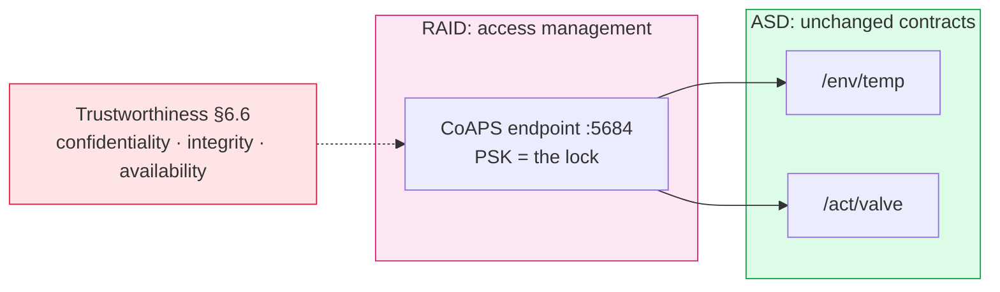

# Lab 6: A Lock on the Bytes — DTLS and the Trustworthiness Viewpoint
> - **Talk:** [06_security.md](../presentations/06_security.md) · **SOP:** [SOP-06: CoAP over DTLS](sops/sop06_security.md)
> - **Reading:** RFC 6347 §4.2 (the DTLS handshake) · RFC 7925 (TLS/DTLS profiles for IoT) · ISO/IEC 30141:2024 §6.6

**GreenField Technologies — SoilSense Project** · Phase: Hardening · 3 hours

**From:** Edward (Security Lead) — *"I sat in the farmhouse with the guest Wi-Fi password,
read every soil temperature with a free CoAP app, then sent the valve an OPEN. Daniela's
seedlings would have drowned. The Thread network key didn't help: once Lab 5 bridged the
mesh to Wi-Fi, my packets were just routed in. This is stop-ship."*

Lab 5 made `/env/temp` and `/act/valve` reachable from the access network, and flagged the
door it opened. Today you put a lock on the bytes: CoAP over DTLS with a pre-shared key
(CoAPS), then you measure what the lock costs and look at it on the wire.

| Stakeholder | Their question | How this lab answers |
|---|---|---|
| **Edward (Security)** | Can an attacker still read the sensor or forge an OPEN? | Task B: plain CoAP refused, the wrong key refused, the right key served. |
| **Daniela (farmer)** | Is my farm data private, and does my phone still work? | Tasks D–E: ciphertext on the wire; the dashboard over DTLS. |
| **Edwin (Ops)** | What does the lock cost my batteries? | Task C: the handshake, once per session, against the reading. |
| **ISO 30141 auditor** | Have you addressed Trustworthiness? | The §6.6 audit, all seven rows, and DTLS placed as RAID's access management. |

Unfamiliar terms (DTLS, PSK, AEAD, STRIDE) are in the [glossary](../docs/glossary.md).

## What you'll measure

Hand in the prediction column before the lab. Use your Lab 5 network: the OTBR, S and C.

| Quantity | Prediction | Your value | Target |
|---|---|---|---|
| Plain CoAP GET from the laptop to S | ____ | works? ____ | refused |
| GET with the wrong key | ____ | works? ____ | refused |
| DTLS handshake, C → S inside the mesh | ____ | ____ ms | — |
| DTLS handshake, laptop → S through the OTBR | ____ | ____ ms | < 3 s |
| GET over an open session, laptop → S | ____ | ____ ms | your Lab 5 value |
| Bytes a DTLS record adds to one CoAP message | ____ | ____ B | — |
| Clients S serves at the same time | ____ | ____ | — |

## Tasks

**Per pair:** the Lab 5 setup: the OTBR (ESP32-S3 and its RCP), S with its sensor, C, the
laptop on the hotspot. The `/env/temp` and `/act/valve` contracts don't change: only how
they are reached.

### Task A — The threat model, on paper first
- For the attacker in Edward's memo, fill a STRIDE table in your DDR: at least three
  concrete threats (one each for information disclosure, tampering of `/act/valve`, and
  denial of service) and the control you expect to stop each one. The rest of the lab
  tests it.
- **Evidence:** the STRIDE table, dated before Task B.

### Task B — Lock the nodes
- Flash [`firmware/lab6_secure`](../firmware/lab6_secure) to S (with its sensor overlay)
  and C ([SOP-06 §1](sops/sop06_security.md#1-build-flash-and-rejoin)). It is the Lab 4 node
  with its CoAP server moved to DTLS on UDP 5684, and a `coaps` shell client.
- Try S four ways: plain CoAP from the laptop and from C; CoAPS from C and from the laptop
  with the lab key; and CoAPS from the laptop with a wrong key
  ([SOP-06 §2–§4](sops/sop06_security.md#2-plain-coap-is-refused)). Which attempts get an
  answer, and what does each failure look like?
- **Evidence:** the five outputs, and S's log for the requests it served.

### Task C — What the lock costs
- Time the handshake from C (inside the mesh) and from the laptop (through the OTBR). With
  `-v`, the laptop prints every flight: count them, and explain where the time goes.
- Time 10 GETs over one session and compare with your Lab 5 plain-CoAP number.
- Estimate the energy: the extra radio-on time per handshake at the ESP32-C6's RX current
  (datasheet), against one reading. How many readings must a session carry before the
  handshake is under 10 % of the cost? That number is your session policy.
- **Evidence:** both handshake times, the flight log, the RTT comparison and the
  arithmetic.

### Task D — Look at the wire
- Capture the laptop's Wi-Fi while it runs a CoAPS GET
  ([SOP-06 §5](sops/sop06_security.md#5-capture-the-wire)). Find the handshake flights and
  the application-data records. Can you find `a1 61 74` anywhere?
- From the record length, work out how many bytes DTLS adds to one CoAP message, and where
  each of them goes.
- **Evidence:** a screenshot of the capture with one application-data record expanded, and
  the byte breakdown.

### Task E — Daniela's dashboard, locked
- Run the dashboard over DTLS and open it on your phone; open and close the valve from
  there ([SOP-06 §6](sops/sop06_security.md#6-the-dashboard-over-dtls)).
- **Evidence:** a phone screenshot and S's log line for the PUT.

### Task F (optional) — How many clients?
- Open sessions to S from several terminals at once until one fails
  ([SOP-06 §7](sops/sop06_security.md#7-count-the-sessions)). What does the failure look
  like to the client, and what does it mean for Edward's denial-of-service row?
- **Evidence:** the session count and the failing client's output.

## ISO/IEC 30141 mapping

The **Trustworthiness viewpoint** (§6.6) is cross-cutting: not a box on the domain map, but
an audit of every box. DTLS is one control that moves several of its rows from gap to
addressed. On the Functional viewpoint's map it realises **RAID's access-management**
component (Figure A.5): the PSK-gated endpoint decides who may exercise the ASD
capabilities. RAID's other half, the interchange subsystem, is Lab 7.

Two encryptions now protect a reading: Thread's link layer (Lab 2: hop by hop, one key
for the whole mesh) and DTLS (today: end to end, per session). Why does the system need
both?

## Deliverables

Update [your DDR](../docs/ddr_template.md):

- **§2 Lab log, *To Edward*:** can the attacker still read `/env/temp` or forge
  `/act/valve`, and what the lock costs. Cite Tasks B–C.
- **§3 ADR-006, PSK or certificates:** the decision for the pilot, with the Task C numbers;
  what a shared PSK gives up (per-device identity, revocation of one node) and the fleet
  size that would force certificates.
- **§4 ISO mapping:** the CoAPS endpoint (UDP 5684, `TLS_PSK_WITH_AES_128_CCM_8`, one
  session per client) as RAID access management. The ASD entries stay as they are.
- **§5 First principles:**
  1. Why DTLS and not TLS for CoAP?
  2. Why does one AEAD tag give both confidentiality and integrity?
  3. Why is authentication, not encryption, what stops the forged OPEN?
  4. Why does a wrong key produce silence instead of an error message?
- **§6 Performance:** the row "Lab 6: DTLS Time" (< 3 s), and the per-record byte overhead.
- **§7 Ethics:** *privacy*: which data is now encrypted in transit; *safety*: the forged
  command refused; *transparency*: the key is hardcoded in the lab build. Say so, and where
  it would live in production.
- **§8 Viewpoints:** the Trustworthiness row, Labs Addressed = "Labs 4, 6".
- **§9 Trustworthiness audit:** all seven rows, with Lab 4's evidence kept and today's
  added. Two gaps DTLS leaves open: firmware integrity (signed updates, Lab 8) and noticing
  an attack or a dead node (Lab 7).

## Grading (100 pts)

| | pts |
|---|---|
| **Technical execution** — nodes on CoAPS, plain CoAP refused (10) · right key served, wrong key refused, from C and the laptop (10) · handshake and session costs measured (10) · the capture with the byte breakdown (10) | 40 |
| **ISO/IEC 30141** — §9 audit, seven rows with evidence and gaps (12) · STRIDE table with three threats and controls (8) · DTLS placed as RAID access management, ASD unchanged (10) | 30 |
| **First principles** — Q1 (5) · Q2 (5) · Q3 (5) · Q4 (5) | 20 |
| **Communication** — ADR-006 with numbers (5) · the "To Edward" entry (5) | 10 |
| **Ethics (pass/fail)** — the forged command shown refused, not claimed; the hardcoded key documented | ✓ |

## Resources & next week

RFC 6347 (DTLS 1.2) · RFC 6655 (AES-CCM in TLS) · RFC 4279 (PSK cipher suites) ·
RFC 7925 (the IoT profile) · ISO/IEC 30141:2024 §6.6

**Lab 7:** Edwin can't see 200 nodes from a shell. Next week the fleet reports its own
health, and the data leaves the mesh for a real dashboard.
