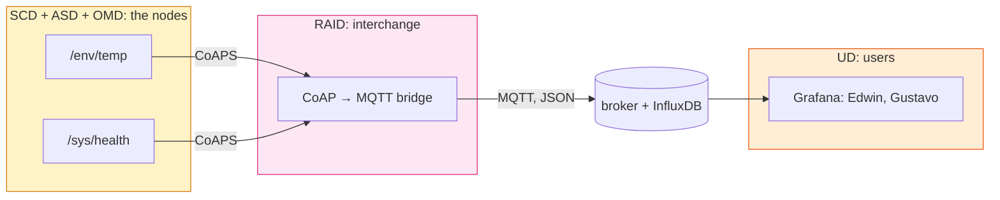

# Lab 7: The Fleet on One Screen — Telemetry, the Bridge and the Dashboard
> - **Talk:** [07_fleet.md](../presentations/07_fleet.md) · **SOP:** [SOP-07: Telemetry, the bridge and the fleet dashboard](sops/sop07_fleet.md)
> - **Reading:** ISO/IEC 30141:2024 §6.4 (Usage viewpoint, Table 4) and Figure A.5 (OMD, RAID) · the MQTT 3.1.1 overview

**GreenField Technologies — SoilSense Project** · Phase: Operations · 3 hours

**From:** Edwin (Field Operations Lead) — *"Stop flying blind. Yesterday node 4 went dark
and I had no idea why: battery, crash, or did someone walk off with it? Today I check a
node by sitting next to it with a laptop. I can't do that for 200 sensors in three fields.
I need the fleet on one screen, and a light that turns red before a node dies, not after."*

Today every node reports its own health, the readings leave the mesh through a bridge
to an MQTT broker, and the fleet lands on the kind of dashboard an operations team
actually runs: InfluxDB for the history, Grafana for the screen.

| Stakeholder | Their question | How this lab answers |
|---|---|---|
| **Edwin (Ops)** | Which node needs a visit, and why? | Tasks A and D: battery, link, uptime, silence, each with a red threshold. |
| **Gustavo (Product)** | Is the fleet healthy at a glance? | Task C: every node on one dashboard, on a laptop or a phone. |
| **Edward (Security)** | Is anyone attacking us right now? | Task D: failed DTLS handshakes, counted on the node and shown in red. |
| **Daniela (farmer)** | Is the system working? | The status lights answer without a single dBm. |
| **ISO 30141 auditor** | Who operates the system, and how does its data get out? | OMD signals, the Usage viewpoint, and RAID's interchange subsystem. |

Unfamiliar terms (telemetry, MQTT topic, time-series database) are in the
[glossary](../docs/glossary.md).

## What you'll measure

Hand in the prediction column before the lab. Labs 7–8 run in teams of four: two pairs,
one fleet.

| Quantity | Prediction | Your value | Target |
|---|---|---|---|
| A `/sys/health` notification, CoAP bytes | ____ | ____ B | — |
| Your report period | ____ | ____ s | — |
| Radio-on time per day for health reports, one node | ____ | ____ s | — |
| A node goes silent → its light turns red | ____ | ____ s | < 3 min |
| A wrong-key probe → the failed-handshake count shows it | ____ | ____ s | — |
| Nodes on the dashboard at once | ____ | ____ | every node in the team |

## Tasks

**Per team:** every node of both pairs, the OTBR of one pair, one laptop on its hotspot
with Docker ([setup](../docs/setup.md#7-docker-for-labs-7-and-8)). Agree on one DTLS key
for the team.

### Task A — Every node reports its own health
- Flash [`firmware/lab7_telemetry`](../firmware/lab7_telemetry) to every node with the team
  key ([SOP-07 §1](sops/sop07_fleet.md#1-build-and-flash)). It is the Lab 6 node plus
  `/sys/health`: battery (simulated), link RSSI, uptime and failed DTLS handshakes, as
  CBOR.
- Read it with `health` on a node's shell and with a CoAPS GET. Decode the CBOR.
- Choose the report period: battery and uptime drift over hours, not seconds. Price it in
  radio-on time per day with your Lab 3 energy numbers.
- **Evidence:** a decoded `/sys/health` message, its size from the node's log, and your
  period with the arithmetic (ADR-007).

### Task B — The data leaves the mesh
- Start the fleet stack and run the bridge for every node
  ([SOP-07 §2–§3](sops/sop07_fleet.md#2-start-the-fleet-stack)). The bridge holds one DTLS
  session per node, observes `/env/temp` and `/sys/health`, and republishes them as JSON
  on `soilsense/<node>/env` and `soilsense/<node>/health`.
- Subscribe to `soilsense/#` with `mosquitto_sub`. Inside the mesh a reading is CoAP,
  CBOR and IPv6; what is it on the broker? Which component translates?
- **Evidence:** `mosquitto_sub` output with every node of the team.

### Task C — The fleet on one screen
- Open the dashboard on the laptop and on a phone ([SOP-07 §4](sops/sop07_fleet.md#4-open-the-dashboard)).
  For each panel, write which question it answers and for whom.
- **Evidence:** a screenshot with every node in the fleet table.

### Task D — Make it turn red
- Run four drills and time each one from the action to the dashboard's change
  ([SOP-07 §5](sops/sop07_fleet.md#5-the-drills)): pull a node's power; set a node's
  battery below 3000 mV; probe a node with a wrong key; reboot a node.
- For a silent node, list what could have happened (battery, crash, jamming, theft, a
  sleepy node between polls). Which of them can the dashboard tell apart, and what one
  extra signal would separate two more?
- **Evidence:** the four times and a screenshot of each red state.

### Task E (optional) — The real internet
- Point the same bridge at a cloud MQTT broker over TLS
  ([SOP-07 §6](sops/sop07_fleet.md#6-a-cloud-broker)). What changed in the bridge, and what
  didn't?
- **Evidence:** the cloud console showing your nodes' messages.

## ISO/IEC 30141 mapping

The health signals are an **OMD** capability (Operation & Management Domain): the node
reports on itself for whoever operates it. The bridge is **RAID's interchange subsystem**,
the half Lab 6 left gray: it exposes ASD and OMD data to consumers outside the system and
fuses it, Table A.3's *information fusion* that Lab 5 deferred. The **Usage viewpoint**
(§6.4) reads all of it through roles and lifecycle: who watches, and what happens between
"red" and a battery swap.

The OTBR still only routes; the bridge parses and re-encodes. Is the bridge a new single
point of failure for the valve, or only for visibility?

## Deliverables

Update [your DDR](../docs/ddr_template.md):

- **§2 Lab log, *To Gustavo*:** can he see the fleet's health at a glance, and how a
  reading gets from a field node to his screen (name every hop).
- **§3 ADR-007, telemetry and the broker:** the report period with its energy cost, a
  separate `/sys/health` against piggybacking on `/env/temp`, and the broker: the local
  stack for the pilot, a cloud broker as the option. Why the bridge is the architecture and
  the broker a configuration line.
- **§4 ISO mapping:** the health signals as OMD; the bridge as RAID interchange. The
  OTBR stays an SCD-hosted gateway, and Lab 6's access management is unchanged.
- **§5 First principles:**
  1. Why isn't telemetry business data? Audience, cadence, cost.
  2. Why a broker instead of every phone reaching every node over IPv6?
  3. Why is silence the hardest signal to read?
- **§6 Performance:** the row "Lab 7: silent node to red" and your report period.
- **§7 Ethics:** *data minimization*: what you chose not to report; *transparency*: the
  data now leaves the device: to which broker, on whose machine, who can subscribe.
- **§8 Viewpoints:** the Usage row, Labs Addressed = "Lab 7".
- **§9 Trustworthiness audit:** close Lab 6's detection gap with Task D's evidence. What
  remains for Lab 8: acting on what you see.

## Grading (100 pts)

| | pts |
|---|---|
| **Technical execution** — health on every node, period chosen (10) · the bridge with every node on the broker (10) · the dashboard with the team's fleet (10) · four drills timed (10) | 40 |
| **ISO/IEC 30141** — OMD signals mapped (10) · RAID interchange placed, not confused with the OTBR or access management (10) · the Usage row (10) | 30 |
| **First principles** — Q1 (6) · Q2 (7) · Q3 (7) | 20 |
| **Communication** — ADR-007 with numbers (5) · the "To Gustavo" entry (5) | 10 |
| **Ethics (pass/fail)** — minimization and the data's destination documented | ✓ |

## Resources & next week

ISO/IEC 30141:2024 §6.4 and Figure A.5 · RFC 7641 (Observe) ·
[MQTT 3.1.1](https://docs.oasis-open.org/mqtt/mqtt/v3.1.1/mqtt-v3.1.1.html) ·
[Grafana](https://grafana.com/docs/grafana/latest/) · [InfluxDB 2](https://docs.influxdata.com/influxdb/v2/) ·
[Telegraf MQTT consumer](https://github.com/influxdata/telegraf/tree/master/plugins/inputs/mqtt_consumer)

**Lab 8:** Samuel flashes your binary and runs the chaos script. You've watched the fleet;
next week it has to survive on its own.
