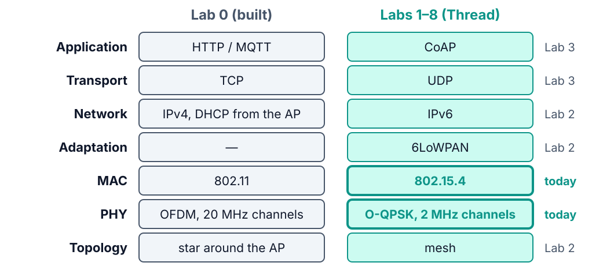
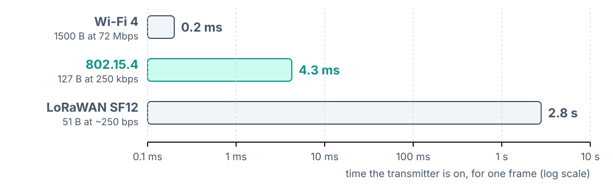
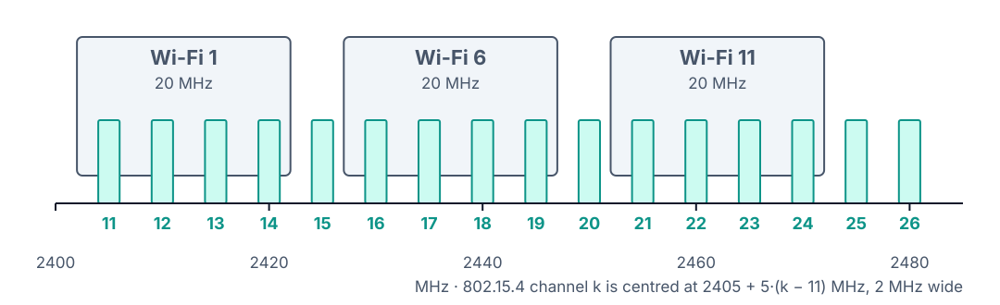
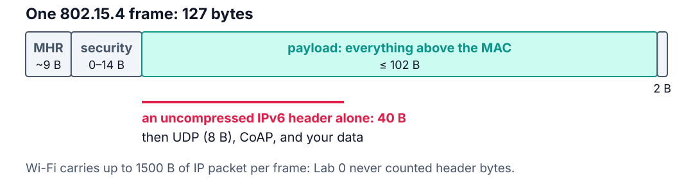
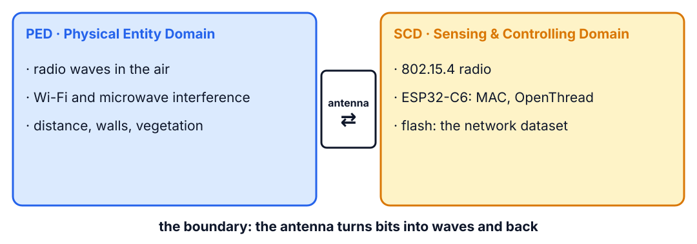

<!--
theme: course
paginate: true
title: The radio
style: |
  section { --course: #1d4ed8; }
-->

<!-- _class: lead -->
<!-- _paginate: false -->

# The radio

**Session 1** · why the battery picks the radio, and what that radio gives you

How far can two SoilSense nodes sit apart, and still deliver 99 % of their packets?

<!--
0:00–1:30. Callback to Lab 0: the same board talked HTTP and MQTT over Wi-Fi. Samuel's
memo for today asks for field data, not vendor specs: range, the cleanest channel, and
the RSSI that predicts a safe link. Today walks down to the bottom of the stack to
answer it.
-->

---

<!-- _class: agenda -->

## Today

1. **From Lab 0 to Thread**: a new stack
2. **PHY and MAC**: what every radio decides
3. **802.15.4**: our radio, with numbers
4. **Thread and ISO/IEC 30141**: roles, and where the device ends
5. **Lab**: what you'll measure

By the end you can compare radios, predict a frame's airtime, and pick a channel away from Wi-Fi.

<!--
1:30–2:30. The colored tag on each slide says which segment we are in. Reading:
theory_foundations.md §1.
-->

---

<!-- _class: s1 question -->
<!-- _header: 1 · From Lab 0 to Thread -->

## In Lab 0, telemetry went out at QoS 0 and commands at QoS 1. Why the difference?

1. QoS 1 is slower, so it is kept for rare messages
2. A lost reading is replaced by the next one; a lost command is not
3. The broker only accepts commands at QoS 1
4. Commands are larger and need acknowledgements to be split

<!--
2:30–5:00. Vote, one minute in pairs, vote again. Answer: B. Reliability is chosen
per message type, not per system; CoAP will offer the same choice in Lab 3 (NON and
CON). A treats QoS as a speed knob; C and D invent constraints. Follow-up, no vote:
what kept the MQTT connection alive between publishes, and what did the radio do
meanwhile? Keepalives over TCP, and a Wi-Fi radio associated to the AP all day. That
is the part a battery can't afford.
-->

---

<!-- _class: s1 figure -->
<!-- _header: 1 · From Lab 0 to Thread -->

## Same capabilities, a new stack under them

<!--
5:00–9:00. What stays: sensing and actuating, the ISO domains, request/response
against publish/subscribe (CoAP has both: GET and Observe). What changes: every
layer under the application, and the reason is energy: 3 months on 2× AA is about
4.2 mW on average (3000 mAh × 3 V over 7.8 × 10⁶ s). The course walks down to the
radio and back up, one layer per lab. Today is the bottom two rows.
-->

---

<!-- _class: s2 -->
<!-- _header: 2 · PHY and MAC -->

## Every radio makes the same two decisions

- **PHY**: bits into a waveform and back. Its knobs: band, channel width, modulation, TX power, receiver sensitivity. It trades rate, range and energy per bit
- **MAC**: who talks when, frames and addresses, a checksum (FCS), and recovery by ACK and retry

<!--
9:00–12:00. Three MAC families to name out loud: contention (Wi-Fi, 802.15.4: listen,
then talk), scheduling (BLE connections: agree on when to meet, sleep in between) and
ALOHA (LoRaWAN: just talk, and accept collisions because traffic is rare).
Misconception: "a faster radio saves energy". Only if the radio can sleep right
after; the next slides show why Wi-Fi can't.
-->

---

<!-- _class: s2 -->
<!-- _header: 2 · PHY and MAC -->

## Four radios on the same axes

| | Wi-Fi 4 | 802.15.4 | BLE | LoRaWAN |
|---|---|---|---|---|
| Band | 2.4 GHz | 2.4 GHz | 2.4 GHz | sub-GHz |
| Channel | 20 MHz | 2 MHz | 2 MHz | 125 kHz |
| PHY rate | 72 Mbps | 250 kbps | 1 Mbps | ~0.3–22 kbps |
| Max frame | ~2300 B | 127 B | 27–251 B | ~50–250 B |
| Access | CSMA/CA | CSMA-CA + ACK | scheduled | ALOHA |

<!--
12:00–15:00. Wi-Fi is the anchor: they used it last week. The 802.15.4 column is the
course. LoRaWAN wins on range (2–15 km rural) and loses on everything a valve needs:
duty-cycle rules (1 % in EU868 is 36 s of airtime per hour), no IP (the network server
translates), rare downlinks. GreenField would pick it for a 10 km pasture, not for
dense in-field sensing with actuators. Max frames: BLE 27 B, 251 B with data-length
extension; LoRaWAN by region and data rate.
-->

---

<!-- _class: s2 figure -->
<!-- _header: 2 · PHY and MAC -->

## How long the transmitter stays on for one frame

<!--
15:00–17:00. Same question for each radio. 802.15.4: 6 B of preamble, SFD and length
plus 127 B, at 32 µs per byte: 4.3 ms. Wi-Fi: 1500 B at 72 Mbps is 0.17 ms of data,
about 0.2 ms with the preamble: ten times the payload in a twentieth of the time.
LoRaWAN SF12 with 51 B of payload: 2.8 s, after which the EU duty cycle keeps the node
quiet for about 4.6 minutes. Computed from the PHY rates; the script is beside the
figure.
-->

---

<!-- _class: s2 question -->
<!-- _header: 2 · PHY and MAC -->

## Wi-Fi sends a frame twenty times faster. Why is it the worst radio for our battery?

1. Its frames spend more time on the air
2. Staying joined to the AP, or rejoining after sleep, keeps the radio on
3. 2.4 GHz Wi-Fi needs more TX power than 802.15.4
4. A Wi-Fi radio can't receive while it transmits

<!--
17:00–19:30. Answer: B. A Wi-Fi node that sleeps must re-associate and redo DHCP when
it wakes, often a second or more of radio-on time to send a few bytes; one that stays
associated listens to beacons all day. 802.15.4 was built to wake, send one small
frame and sleep. A contradicts the last slide. C is a second-order effect. D is true
of every half-duplex radio, 802.15.4 included.
-->

---

<!-- _class: s3 -->
<!-- _header: 3 · 802.15.4 -->

## O-QPSK and DSSS: a cheap amplifier and robust bits

- **O-QPSK** with half-sine pulses has a constant envelope, so a non-linear amplifier works: 70–80 % efficient instead of 30–40 %
- **DSSS**: every 4 bits become one of 16 sequences of 32 chips. 2 Mchip/s carries 250 kbps, about **9 dB** of processing gain
- A few corrupted chips still decode to the right symbol

<!--
19:30–22:30. O-QPSK delays Q by half a pulse, so I and Q never change together and
the phase never jumps 180°: roughly double the battery life from the amplifier alone.
DSSS is why an 802.15.4 link survives next to a much louder Wi-Fi transmitter: the
receiver correlates against the 16 known sequences. The optional DDR question 3 asks
them to explain this in their own words, so keep it to the mechanism.
-->

---

<!-- _class: s3 figure -->
<!-- _header: 3 · 802.15.4 -->

## Sixteen 2 MHz channels under three Wi-Fi networks

<!--
22:30–25:00. License-free worldwide, which is why it's crowded. Ask: which 802.15.4
channels does each Wi-Fi channel cover, and which fall in the gaps? Let them read it
off the figure; this is the picture to keep in mind during `ot scan energy`. Most
farmhouse routers sit on Wi-Fi 1, 6 or 11, but a phone hotspot can land anywhere.
-->

---

<!-- _class: s3 -->
<!-- _header: 3 · 802.15.4 -->

## Listen before talking, retry until acknowledged

- **CSMA-CA**: wait 0–7 slots of 320 µs, listen 128 µs. Busy? Double the window (up to 31 slots). Five busy checks: give up
- **ACK and retry**: 802.15.4 defaults to 3 retries; OpenThread uses **15**
- Your measured loss is what is left after up to 16 attempts

<!--
25:00–28:00. Ask: Ethernet detects collisions (CSMA/CD); why can't a radio? A
half-duplex radio can't hear while it transmits, so it can only avoid collisions and
learn about one later from a missing ACK. Lab 1's optional Task E counts the hidden
retransmissions with the MAC counters.
-->

---

<!-- _class: s3 figure -->
<!-- _header: 3 · 802.15.4 -->

## 127 bytes: the number to remember

<!--
28:00–30:00. After the MAC header, security and FCS, roughly 80–100 bytes remain for
everything above: IPv6 (40), UDP (8), CoAP, data. In Lab 0 nobody counted header
bytes; from Lab 2 on everyone does. Leave the red bar up: it is next week's problem,
and 6LoWPAN is the answer.
-->

---

<!-- _class: s4 -->
<!-- _header: 4 · Thread and ISO/IEC 30141 -->

## Thread builds a network on 802.15.4

| Role | Does | Seen in |
|---|---|---|
| Leader | hands out router IDs | Lab 1, A |
| Router | forwards; up to 32 | Lab 1, B |
| REED | a child that may promote | Lab 1, B at first |
| Sleepy end device | radio off, polls its parent | Lab 3 |
| Border router | mesh ↔ Wi-Fi | Lab 5 |

<!--
30:00–32:30. Thread adds 6LoWPAN, IPv6 with mesh routing, UDP, MLE (how devices find
neighbours, attach and rate links) and network security. It stops below the
application: CoAP is the usual choice, and Matter runs on Thread. Hook: nobody
configures B as a router. It joins as a child, sees room for another router and
promotes itself; Lab 2 stress-tests that self-organization.
-->

---

<!-- _class: s4 figure -->
<!-- _header: 4 · Thread and ISO/IEC 30141 -->

## Where the device ends and the physical world begins

<!--
32:30–34:30. Ask first: where does the ESP32-C6 live, and where does the RF link
live? The electromagnetic field is a physical phenomenon, so propagation and
interference are PED; the radio is SCD; the antenna is the boundary. The standard
calls this link proximity networking. Then the capabilities model (§9, Tables 9–10):
transducer, data, interface, supporting, latent. In Lab 0 the Wi-Fi radio was active;
today it is latent and the 802.15.4 radio is active. Same board, different table:
students fill theirs in the lab.
-->

---

<!-- _class: takeaway -->

## The one thing to remember

> The battery picks the radio, and the radio's 127-byte frame shapes every layer above it.

<!--
34:30–35:00. Read it aloud; it is the first line of today's DDR entry.
-->

---

<!-- _class: s5 -->
<!-- _header: 5 · Lab -->

## Today in the lab

| You measure | Predict now |
|---|---|
| Noise floor of the quietest channel | ____ dBm |
| RSSI at 1 m | ____ dBm |
| RSSI drop per doubling of distance | ____ dB |
| RSSI below which loss exceeds 1 % | ____ dBm |
| Maximum reliable range | ____ m |

Predictions are due before you power the boards.

<!--
35:00–39:00. Walk Tasks B–D. Energy scan: lower is quieter; check it against the
band figure. RSSI against distance: about 6 dB per doubling in free space, much more
through walls and vegetation. Practical: copy the whole dataset as hex (the network
key is random); the same TX power on every board in the room; 100 pings per point,
one direction at a time; RSSI from `ot neighbor table` on the receiving side. Radios
off when not testing: shared spectrum is a trustworthiness concern.
Seed the puzzle, don't answer it (it is DDR question 2): the receiver decodes near
−100 dBm, yet losses start well above that. Where do the missing decibels go?
-->

---

## References

- IEEE 802.15.4-2020, Clause 6 (MAC) and Clause 8 (PHY)
- ISO/IEC 30141:2024 §9, Tables 9–10 (component capabilities)
- [theory_foundations.md](../docs/theory_foundations.md) §1: O-QPSK, link budget, CSMA-CA
- [technology_landscape.md](../docs/technology_landscape.md): the stacks compared
- [Lab 1](../labs/lab1.md) · [SOP-01](../labs/sops/sop01_radio.md)

<!--
39:00–40:00. Questions, then the lab.
-->
