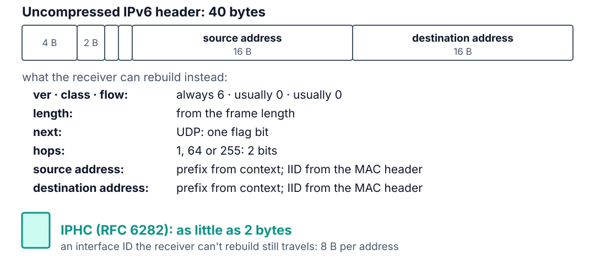
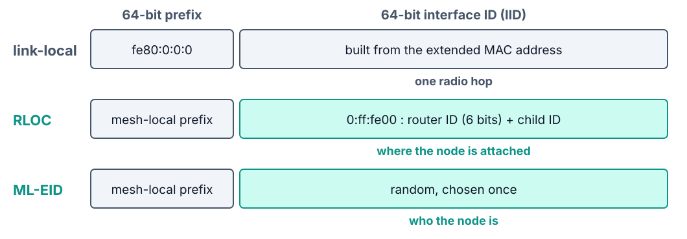
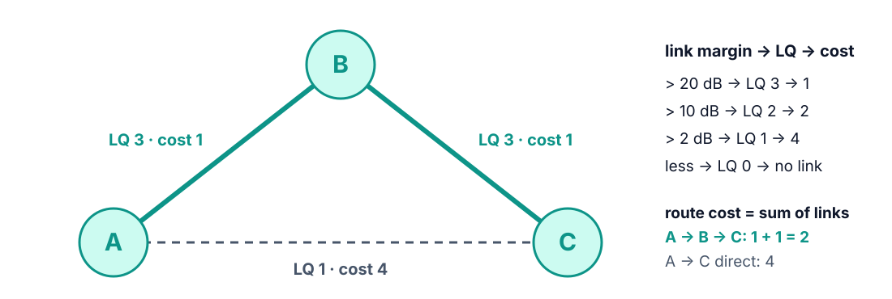

<!--
theme: course
paginate: true
title: The mesh
style: |
  section { --course: #1d4ed8; }
-->

<!-- _class: lead -->
<!-- _paginate: false -->

# The mesh

**Session 2** · IPv6 through a 127-byte door, and a network that routes around a crushed node

If a tractor flattens a router, how long until the field talks again?

<!--
0:00–1:30. Callback: last week ended on the red bar, 40 bytes of IPv6 header in
about 100 bytes of room. Edwin's memo for today: a tractor took out a node and
everything behind it went dark. Today: how IPv6 fits, how Thread routes, and how it
heals.
-->

---

<!-- _class: agenda -->

## Today

1. **The 127-byte door**: header compression and fragments
2. **Addresses**: four kinds, four jobs
3. **Routing and healing**: link quality, costs, detection
4. **Roles and other meshes**: who stays awake; BLE Mesh, Zigbee
5. **Lab**: what you'll measure

By the end you can classify a node's addresses, compute a route's cost, and predict
how a mesh notices a dead router.

<!--
1:30–2:30. Reading: theory_foundations.md §2–§3. RFC 6282 is the one RFC worth
skimming this week.
-->

---

<!-- _class: s1 figure -->
<!-- _header: 1 · The 127-byte door -->

## Inside one mesh, most of the IPv6 header is predictable

<!--
2:30–7:00. Ask first: 40 bytes of header, about 100 of room, what are the options?
Compress or fragment; 6LoWPAN (RFC 6282, RFC 4944) does both. Walk the fields: version
is always 6; traffic class and flow label are usually 0; the length comes from the
frame; UDP is one flag and its header is compressed too (NHC); the hop limit is one of
three common values. The big win is the 32 bytes of addresses: the prefix is
link-local or the mesh-local prefix every node holds as context 0, and an interface
ID the receiver can rebuild from the MAC header is never sent. Remember the number 2:
it makes the 127-byte frame livable.
-->

---

<!-- _class: s1 question -->
<!-- _header: 1 · The 127-byte door -->

## 6LoWPAN compresses headers but never the payload. Why?

1. Compressing the payload would cost too much CPU
2. Headers are predictable from context; a payload isn't
3. The payload is already encrypted by the MAC
4. RFC 6282 reserves payload compression for TCP

<!--
7:00–9:30. Vote, pairs, vote again. Answer: B. Headers have a known syntax and local
context; a payload is arbitrary bytes. Compressing the payload is the application's
job: that is what CBOR does in Lab 3. C mixes up the order: 6LoWPAN works on the
packet before the MAC encrypts the frame. A and D are invented.
-->

---

<!-- _class: s1 -->
<!-- _header: 1 · The 127-byte door -->

## When compression isn't enough: fragments

- Larger datagrams split into a **first fragment** (4-byte header) and **next fragments** (5 bytes)
- Lose one fragment and the whole datagram is lost; OpenThread drops a half-built datagram after 2 s
- Only the layer above can resend it

Keep application payloads small enough to fit one frame.

<!--
9:30–11:30. Examples that fragment: a DTLS handshake record (Lab 6), an OTA block, a
long JSON diagnostic. RFC 4944 allows up to 60 s for reassembly; OpenThread gives up
after 2 s. Big packets are expensive on lossy radios, and this shapes Lab 3's
CoAP/CBOR design. The optional Task F finds the one-frame limit on their boards.
-->

---

<!-- _class: s2 figure -->
<!-- _header: 2 · Addresses -->

## Every node carries several addresses, each with one job

<!--
11:30–15:00. Students will see three or four unicast addresses with `ot ipaddr`. The
RLOC encodes the router ID and child ID, so it changes whenever the node attaches
somewhere else. The ML-EID is random and never changes. The leader also carries an
ALOC ending in fc00: an anycast address for a role, not a device. Multicast: ff02::1
all nodes on this link, ff03::1 all nodes in the mesh, ff02::2 and ff03::2 routers
only. Don't say which address an application should use: Samuel asks that in the lab,
and the optional DDR question 4 makes them find out.
-->

---

<!-- _class: s3 question -->
<!-- _header: 3 · Routing and healing -->

## A–B and B–C are good links (LQ 3). A–C is poor (LQ 1). How does A send to C?

1. Directly: one hop beats two
2. Through B
3. Both paths, alternating
4. Whichever path answered first

<!--
15:00–17:00. Answer: B, shown on the next slide. Misconception in A: fewer hops is
better. Thread minimizes cost, and a poor link costs more than two good hops. C and D
describe flooding or racing, which Thread does not do.
-->

---

<!-- _class: s3 figure -->
<!-- _header: 3 · Routing and healing -->

## Hops are cheap; bad links are expensive

<!--
17:00–20:00. Link margin is the received signal minus the noise floor (Lab 1's
numbers). Each side tells the other what it measures, so both know the two-way
quality: LQ = min(LQ in, LQ out). Path cost is the sum of link costs. This triangle is
exactly what students build in Lab 2 Task D, with `ot macfilter rss add-lqi` making the
A–C link look like LQ 1 on a desk.
-->

---

<!-- _class: s3 -->
<!-- _header: 3 · Routing and healing -->

## MLE keeps the mesh alive

- **Measures links**: every frame updates a neighbour's average RSSI, mapped to LQ 0–3
- **Assigns router IDs**: the leader hands out 6-bit IDs, at most 32 routers
- **Shares costs**: each router advertises its link quality and path cost to every other router

<!--
20:00–22:00. MLE is Thread's signalling protocol, UDP on link-local addresses. Routing
is distance-vector, compressed to about a byte per router. The advertisement timer
(Trickle) fires every second right after a change and backs off to about 32 s when
the mesh is stable.
-->

---

<!-- _class: s3 -->
<!-- _header: 3 · Routing and healing -->

## Two ways a router learns its neighbour is gone

- **Traffic**: 4 consecutive frames to it go unacknowledged (each already retried). The link is dropped and routes are recomputed at once
- **Silence**: no advertisement from it for **100 s**
- After either, advertisements speed up again, so the new costs spread in seconds

<!--
22:00–25:00. Leave the consequences for the lab. Edwin's target is 2 minutes; the
tractor test tells them which detector fired and why. Question 2 of the DDR asks what
noticed the failure first and what an idle link would do: don't answer it here.
Warn them now: `ot thread stop` on B is not a dead node. Its radio keeps ACKing, so
only the 100 s timer catches it. Pull the cable.
-->

---

<!-- _class: s4 -->
<!-- _header: 4 · Roles and other meshes -->

## Who keeps the receiver on

| Thread role | Function | Receiver |
|---|---|---|
| Leader, router | coordinate, forward | always on |
| REED | standby forwarder | always on |
| End device | leaf | always on |
| Sleepy end device | leaf | off between polls to its parent |

<!--
25:00–27:00. Place each role in the Functional viewpoint: the mesh is the SCD's
communication subsystem; stable ML-EIDs are how ASD services will reach nodes from
Lab 3 on. Ask, don't answer: with Lab 1's 4.2 mW budget, which of these rows can run
3 months on 2× AA? The lab's ISO box asks them to write it down.
-->

---

<!-- _class: s4 -->
<!-- _header: 4 · Roles and other meshes -->

## Same problem, three answers

| | Thread | BLE Mesh | Zigbee |
|---|---|---|---|
| Routing | distance vector | managed flood | tree + on-demand mesh |
| State per node | router table | message cache | routing tables |
| IP end to end | yes | no | no |
| Heals in | seconds with traffic | the next flood | seconds to tens of seconds |

<!--
27:00–31:00. BLE Mesh: every relay rebroadcasts with a TTL; trivially self-healing,
but every packet touches every relay, fine for lights in one building. Zigbee: the
coordinator assigns addresses down a tree, with AODV-style repair; not IP-native, its
application layer is ZCL. Why Thread for GreenField: a cloud service or a phone can
address a sensor by IPv6 (decisive once Lab 5 adds the border router), and routing
cost scales with topology, not with traffic: 50 sensors flooding would saturate the
air. Hook: Thread stapled IPv6, 6LoWPAN and distance-vector routing to 802.15.4. The
value is in the staple.
-->

---

<!-- _class: takeaway -->

## The one thing to remember

> A route follows link quality, not distance: two good hops beat one bad link.

<!--
31:00–31:30. First line of today's DDR entry.
-->

---

<!-- _class: s5 -->
<!-- _header: 5 · Lab -->

## Today in the lab

| You measure | Predict now |
|---|---|
| RTT A → B, 1 hop | ____ ms |
| RTT A → C, 2 hops through B | ____ ms |
| Frames B sends while A pings C 20 times | ____ |
| Healing time after B dies | ____ s |

Predictions are due before you power the boards.

<!--
31:30–38:00. Groups of three boards: pairs team up. Walk Tasks B–E. Same channel, PAN
ID and key everywhere: export A's dataset with `ot dataset active -x`. A random key
from `dataset init new` is also why two groups can't merge by accident; a key typed
from a handout is how anyone could join, a trustworthiness point. LQ In is what I
hear, LQ Out what my neighbour hears from me. Never unplug A in the tractor test:
losing the leader is Task F, with its own 120 s timeout. Radios off when idle.
-->

---

## References

- RFC 6282 (6LoWPAN header compression) · RFC 4944 (fragmentation)
- [Thread primer: IPv6 addressing](https://openthread.io/guides/thread-primer/ipv6-addressing) · [router selection](https://openthread.io/guides/thread-primer/router-selection)
- [theory_foundations.md](../docs/theory_foundations.md) §2–§3
- [Lab 2](../labs/lab2.md) · [SOP-02](../labs/sops/sop02_mesh.md)

<!--
38:00–40:00. Questions, then the lab.
-->
