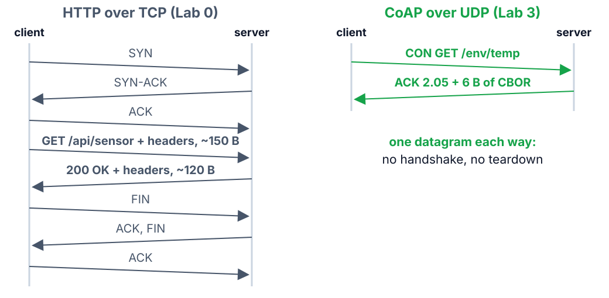
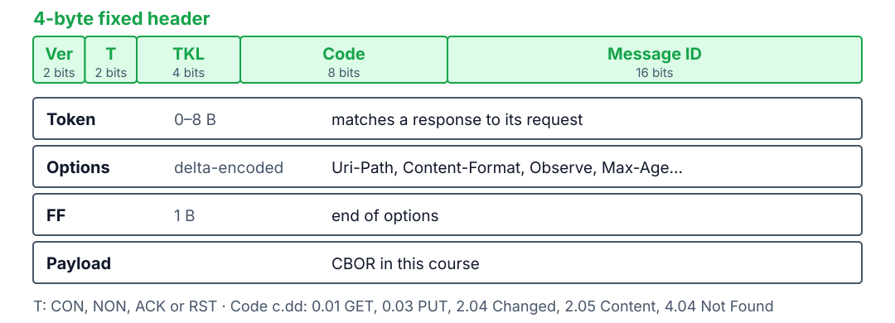
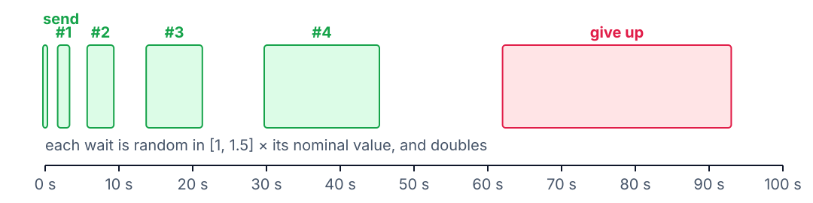
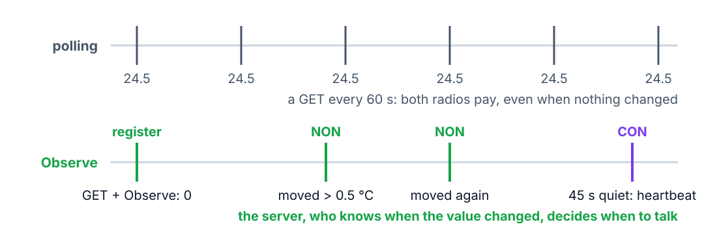
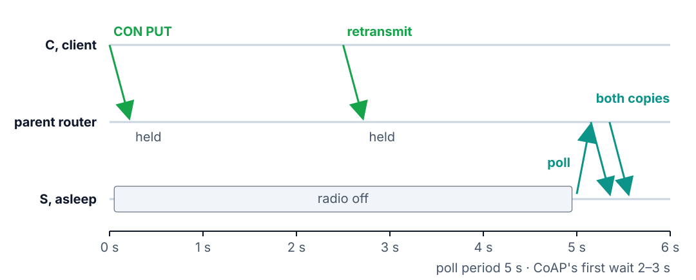

<!--
theme: course
paginate: true
title: CoAP
style: |
  section { --course: #1d4ed8; }
-->

<!-- _class: lead -->
<!-- _paginate: false -->

# CoAP

**Session 3** · reading sensors and commanding valves without TCP

Why did the Wi-Fi prototype's batteries die in four days, and how do we know the valve got the command?

<!--
0:00–1:30. Open with Daniela's two complaints from the lab memo: batteries dead in 4
days with a stale dashboard, and a valve that moved 14 minutes late with nobody sure
it got the command. Neither is a radio problem; Labs 1–2 fixed the radio and the mesh.
Both are about how the application uses the radio: how long it stays on, who decides
when to talk, and what "delivered" means.
-->

---

<!-- _class: agenda -->

## Today

1. **Why HTTP kills batteries**: count the packets
2. **The CoAP message**: four bytes, CON or NON
3. **Observe and CBOR**: push on change, compact bytes
4. **A valve that sleeps**: the parent's mailbox
5. **Lab**: what you'll measure

By the end you can size a message, pick CON or NON, and predict a sleeping valve's
latency.

<!--
1:30–2:30. Lab 3 is the first lab that lives mostly in the Application & Service
Domain: URIs, CBOR contracts, interaction patterns. Reading: theory_foundations.md §4
and RFC 7252 §3–§4.
-->

---

<!-- _class: s1 figure -->
<!-- _header: 1 · Why HTTP kills batteries -->

## Same REST model, a fraction of the packets

<!--
2:30–6:00. Lab 0's handler returned about 20 bytes of JSON. Over TCP that cost 7–9
packets and several hundred bytes: handshake, request headers, response headers,
teardown. Every packet keeps a radio on at both ends, and on a mesh every round trip
crosses several hops. The radio is the battery. CoAP: one request datagram, one
response datagram. CoAP adds no new mental model: COAP_RESOURCE_DEFINE is Lab 0's
HTTP_RESOURCE_DEFINE, NON is MQTT's QoS 0, CON is QoS 1, Observe is a subscription.
Two differences: no broker (any node can be client and server), no connection.
-->

---

<!-- _class: s1 question -->
<!-- _header: 1 · Why HTTP kills batteries -->

## HTTP was designed in 1991 for wired networks. Which of its assumptions hurts most on a battery-powered mesh?

1. Opening a connection is cheap
2. Text is easy to debug
3. Resources have hierarchical URLs
4. A server has an address clients can reach

<!--
6:00–8:30. Answer: A, and its relatives: both ends are always awake, headers are free
because bandwidth is plentiful. B costs bytes but is a convenience, not the killer. C
and D survive intact in CoAP: the URLs and the addressing are exactly what CoAP keeps.
-->

---

<!-- _class: s2 figure -->
<!-- _header: 2 · The CoAP message -->

## Four bytes of fixed header, then only what the request needs

<!--
8:30–12:00. Predict a size together: GET env/temp from the OpenThread shell is 4
(header) + 2 (token) + 4 (`env`: one option byte and 3) + 5 (`temp`) bytes. Students
check it against S's log in Task B. Options are delta-encoded: smaller, and a fixed
order lets a parser make one pass, so the firmware appends Observe (6),
Content-Format (12) and Max-Age (14) in that order.
-->

---

<!-- _class: s2 -->
<!-- _header: 2 · The CoAP message -->

## Two numbers, two jobs

- **Message ID**: the messaging layer. This ACK is for that CON; a repeated ID is a duplicate
- **Token**: the application. This response is for that request
- Observe notifications arrive minutes later with new Message IDs and the **same Token**

<!--
12:00–13:30. Students always ask why both exist. The answer is the layering: CON/ACK
is reliability, request/response is meaning. A piggybacked response carries both in
one datagram.
-->

---

<!-- _class: s2 -->
<!-- _header: 2 · The CoAP message -->

## Reliability is chosen per message

| Message | Type | Because |
|---|---|---|
| Periodic reading | NON | the next one replaces it |
| Notification on change | NON | the next change re-notifies |
| Observe heartbeat | CON | proves the observer is still there |
| Valve command | **CON** | it must arrive, and the client must know |
| Frost alarm | **CON** | it must arrive |

<!--
13:30–15:30. Trap to call out: NON doesn't mean "best effort to deliver". It means
"no acknowledgement at the message layer"; a loss is invisible to the sender. RFC 7641
§4.5 is where the heartbeat comes from.
-->

---

<!-- _class: s2 figure -->
<!-- _header: 2 · The CoAP message -->

## A CON request waits longer after every silence

<!--
15:30–18:30. Compute it with the room (RFC 7252 §4.8): the first wait is ACK_TIMEOUT
× [1, 1.5], 2–3 s, and doubles after each of the MAX_RETRANSMIT = 4 retransmissions.
The last retransmission leaves 30–45 s after the first send; the client gives up
62–93 s after it (MAX_TRANSMIT_WAIT). Task D measures it with the valve gone; the NON
version of the same PUT fails silently, forever. Why doubling: radio losses come in
bursts, and a fixed interval would collide again.
-->

---

<!-- _class: s2 question -->
<!-- _header: 2 · The CoAP message -->

## The valve's ACK is lost and the client sends the request again. Which request is safe to repeat?

1. `PUT /act/valve` with `{"v": 1}`
2. `POST /act/valve/toggle`
3. Both: CoAP drops duplicates
4. Neither: never retransmit a command

<!--
18:30–21:00. Answer: A. PUT sets a state, so running it twice leaves the valve open;
a toggle runs twice and closes it again. C is the dangerous misconception: RFC 7252
lets a server remember Message IDs and replay its response, but the Zephyr CoAP server
in the lab doesn't, so every retransmission reaches the handler. D throws away CON's
whole point. Use PUT for state and POST for events.
-->

---

<!-- _class: s3 figure -->
<!-- _header: 3 · Observe and CBOR -->

## Observe moves "when to talk" to whoever knows the value changed

<!--
21:00–24:00. Register once (GET with Observe: 0); the server pushes. The 0.5 °C
threshold is application policy; CoAP supplies the registration, the token and a
sequence number that lets the client drop reordered notifications. Observe is
eventually consistent, not lossless: a lost NON is superseded by the next one. Max-Age
(60 s) says how long a value stays fresh; the 45 s CON heartbeat keeps the client's
copy fresh on a still day and lets the server drop an observer that vanished. Why not
Observe for everything? Per-observer state on the server, and push needs a client the
server can reach.
-->

---

<!-- _class: s3 -->
<!-- _header: 3 · Observe and CBOR -->

## CBOR: JSON's data model, in bytes

| | On the wire | Size |
|---|---|---|
| JSON `{"t": 24.5}` | `7B 22 74 22 3A 20 32 34 2E 35 7D` | 11 B |
| CBOR | `A1` map · `61 74` "t" · `F9 4E 20` float16 | 6 B |

Self-describing like JSON. **CDDL** (RFC 8610) writes the contract:
`env-reading = { t: float16 }`

<!--
24:00–27:00. Decode 4E 20 on the board: sign 0, exponent 10011 = 19 − 15 = 4,
mantissa 1.53125, so 1.53125 × 2⁴ = 24.5. Half precision gives about 3 significant
digits, enough for soil temperature, and that is a decision to write in the contract.
A fuller reading ({"id", "t", "rh", "ts"}) is 49 B of compact JSON and 30 B of CBOR.
Don't argue against a hand-made struct here: DDR question 4 asks why CBOR wins.
-->

---

<!-- _class: s3 -->
<!-- _header: 3 · Observe and CBOR -->

## Three protocols, one course

| | HTTP | MQTT | CoAP |
|---|---|---|---|
| Transport | TCP | TCP | UDP |
| Pattern | request/response | publish/subscribe | both |
| Broker | no | yes | no |
| Reliability | always | QoS 0/1/2 | NON or CON |

<!--
27:00–28:30. Let them fill it from memory of Lab 0 before revealing. Hook: constraints
pick the protocol, not preferences. The Wi-Fi side of the border router (Lab 5) can
keep HTTP or MQTT; the radio side can't afford them.
-->

---

<!-- _class: s4 figure -->
<!-- _header: 4 · A valve that sleeps -->

## A sleeping valve's mail waits at its parent

<!--
28:30–32:00. A sleepy end device (Lab 2's role table) turns its receiver off between
polls; everything addressed to it waits at its parent. Walk the timeline: C's CON PUT
reaches the parent and is held; C's first wait expires at 2–3 s and it retransmits;
the parent holds that too; at the poll both copies go down. Consequences: the
worst-case downlink latency is about the poll period, and the client sees a slow node,
not a dead one. Uplink is unaffected: the valve can transmit any time. Leave "what
does the second copy do?" for Task E and DDR question 3.
-->

---

<!-- _class: s4 -->
<!-- _header: 4 · A valve that sleeps -->

## The poll period trades latency for battery

average current ≈ (t_on / poll period) × I_rx + I_sleep

- A 30 s poll with 10 ms of radio per poll: on 0.03 % of the time, up to 30 s late
- Opening a valve is human-paced; Daniela won't notice a few seconds
- Thread 1.2 added **CSL**: parent and child agree on listen times instead

<!--
32:00–34:00. Students put the ESP32-C6 datasheet's RX and sleep currents into this for
their energy estimate, at their own poll period. CSL (Coordinated Sampled Listening)
is worth a mention so nobody leaves thinking a sleepy node always means seconds of
latency. Why not poll every second? Battery, and channel occupancy that grows with the
fleet.
-->

---

<!-- _class: takeaway -->

## The one thing to remember

> CON for what must arrive, NON for what the next message replaces, and push from whoever knows the value changed.

<!--
34:00–34:30. First line of today's DDR entry.
-->

---

<!-- _class: s5 -->
<!-- _header: 5 · Lab -->

## Today in the lab

| You measure | Predict now |
|---|---|
| GET round trip, 1 hop | ____ ms |
| GET request / response size | ____ B |
| Notifications in 5 min | ____ |
| CON timeout with the valve gone | ____ s |
| Sleepy valve, 5 s poll: round trip | ____ ms |

Predictions are due before you power the boards.

<!--
34:30–38:30. Walk Tasks A–F. Never `ot coap start` on S: OpenThread would take port
5683 from S's server. The shell sends text, so the valve accepts 0/1 as text; real
clients send CBOR with Content-Format 60, and the contract allows both. The shell
doesn't print response codes; S's log does, so keep both monitors visible. The ping
timeout must exceed the poll period, or Task E reports loss that isn't. Task F puts the
Lab 0 dashboard on top of all this.
-->

---

## References

- RFC 7252 (CoAP): §3 message format, §4 reliability · RFC 7641 (Observe)
- RFC 8949 (CBOR) · RFC 8610 (CDDL)
- [SoilSense API](../docs/api.md) · [theory_foundations.md](../docs/theory_foundations.md) §4
- [Lab 3](../labs/lab3.md) · [SOP-03](../labs/sops/sop03_coap.md)

<!--
38:30–40:00. Questions, then the lab.
-->
