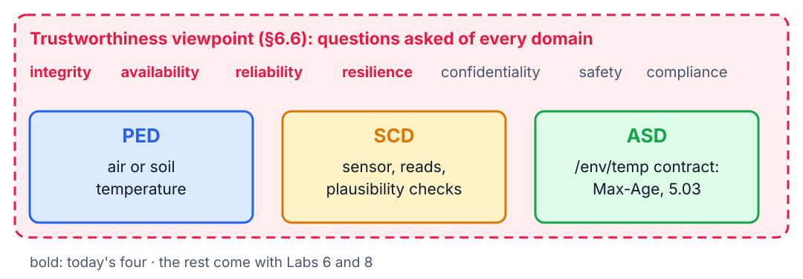
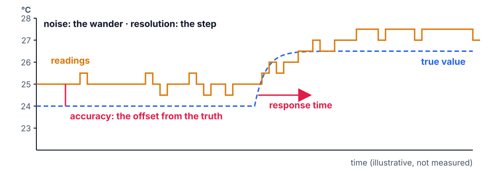
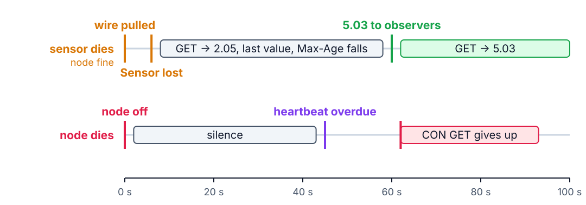

<!--
theme: course
paginate: true
title: Real sensors
style: |
  section { --course: #1d4ed8; }
-->

<!-- _class: lead -->
<!-- _paginate: false -->

# Real sensors

**Session 4** · when to trust a reading, and what a missing one means

The north plot showed 24 °C all afternoon, with its probe pulled out. Could anyone have known?

<!--
0:00–2:00. Read Edwin's memo. Every protocol from Lab 3 worked: GETs were answered,
Observe heartbeats arrived on time. The system was available and wrong. Lab 3's sensor
was a sine wave: always there, always plausible, never late. Today it becomes a part
that can lie, die and lag, and the question changes from "where does this piece sit on
the map?" to "can we trust what it tells us?"
-->

---

<!-- _class: agenda -->

## Today

1. **A new lens**: trustworthiness
2. **Integrity**: what a real sensor gives you
3. **Availability**: freshness and reachability
4. **Reliability and resilience**: busy radios, what heals
5. **Lab**: what you'll measure

By the end you can tell accuracy from resolution, state a freshness promise, and predict what a client sees when a sensor or a node fails.

<!--
2:00–3:00. Reading: ISO/IEC 30141:2024 §6.6, and the datasheet of your sensor.
-->

---

<!-- _class: s1 figure -->
<!-- _header: 1 · A new lens -->

## Trustworthiness is not a seventh domain: it is an audit of all six

<!--
3:00–7:00. Labs 1–3 placed pieces on the Functional viewpoint's domain map. The
Trustworthiness viewpoint (§6.6) adds no box: it is the list of questions an auditor
asks about every box. The standard names seven characteristics (§6.6.2.3); a real
sensor brings four into play today. Its definition of integrity already splits the work
across labs: data "not altered by faulty or unauthorized devices, by malicious actors,
or by environmental causes". Today: faulty devices and environmental causes. Lab 6:
malicious actors and confidentiality.
-->

---

<!-- _class: s2 figure -->
<!-- _header: 2 · Integrity -->

## Four words that get mixed up

<!--
7:00–10:00. Resolution: the smallest step it reports. Accuracy: how far from the truth
it may be (datasheet; a reference). Noise: how much it wanders when nothing changes.
Response time: how fast it follows a real change (the breath test). The figure is
synthetic, drawn to separate the four. The housing is part of the sensor: a steel probe
smooths a breath away, which is what you want in soil; a bare chip sees everything.
-->

---

<!-- _class: s2 question -->
<!-- _header: 2 · Integrity -->

## A sensor prints readings in 0.01 °C steps. What does that tell you about its accuracy?

1. It is accurate to ±0.01 °C
2. It is accurate to ±0.005 °C
3. Nothing
4. It is more accurate than a sensor with 0.1 °C steps

<!--
10:00–12:00. Answer: C. A cheap sensor can print 0.01 °C steps around a value 2 °C
off. A, B and D all read resolution as accuracy. The contract must state accuracy, from
the datasheet, not resolution; Lab 4's ethics line asks for the sensor's real accuracy.
-->

---

<!-- _class: s2 -->
<!-- _header: 2 · Integrity -->

## Faults to expect

| Fault | What it looks like |
|---|---|
| Dead | the read fails: no answer, a timeout |
| Stuck at a limit | the value sits at the edge of the range |
| Power-on default | a fixed, believable number (a DS18B20's 85.0 °C) |
| Spike | one reading far from its neighbours |
| Environmental | real, but not what you meant to measure |

<!--
12:00–14:00. Examples from the course bench: a pulled wire gives "No 1-Wire slaves" or
DHT timeouts; a DHT11 sits at 95 %RH and a DHT22 at 100 %RH for minutes after a
breath; condensation on the humidity element; a hand on the probe. Ask: the DHT11 reads
95 % for ten minutes. A fault? You can't tell from the value, only from context: it is
the top of the range, it got there in seconds, and it isn't moving.
-->

---

<!-- _class: s2 -->
<!-- _header: 2 · Integrity -->

## The checks a node can make, and the value they can't stop

- **Range**: reject below −40 °C or from 85 °C up
- **Step**: reject a jump of more than 5 °C from a reading less than 10 s old
- A value that is **wrong but believable** passes both

<!--
14:00–16:00. Both checks are cheap and catch real faults (85.0 catches the DS18B20's
power-on value). Then ask the room for the case no check catches: 25.5 °C when the
truth is 24.1 °C. What could catch it is DDR question 3; let them argue, don't settle
it. Plant only that an attacker's value is the same problem with a motive: Lab 6.
-->

---

<!-- _class: s3 -->
<!-- _header: 3 · Availability -->

## CoAP already has the words for freshness

| Feature | What it says |
|---|---|
| **Max-Age** (RFC 7252 §5.10.5) | this value is fresh for N more seconds |
| **5.03 Service Unavailable** (§5.9.3.4) | I'm here; the data isn't. Ask again after Max-Age |
| **Error notification** (RFC 7641 §4.2) | ends the observation |
| **CON heartbeat** (Lab 3) | I speak at least every 45 s |

<!--
16:00–18:30. In Lab 4 the server sets Max-Age to 60 s minus the reading's age, and
answers 5.03 once no reading is younger than 60 s. The heartbeat promise turns silence
into information. The contract is in docs/api.md.
-->

---

<!-- _class: s3 figure -->
<!-- _header: 3 · Availability -->

## Two failures, two signatures

<!--
18:30–22:00. Draw both timelines with them; it is the picture Edwin asked for. Top:
the probe is pulled; after three failed reads S logs Sensor lost; GETs keep returning
the last value with a shrinking Max-Age; at 60 s every observer gets a 5.03 and its
observation ends. Bottom: the node leaves; nothing is sent; a heartbeat is overdue; a
CON GET gives up after Lab 3's 62–93 s. Students time both in Task C. Leave the
diagnosis rule to them: it is DDR question 2.
-->

---

<!-- _class: s3 question -->
<!-- _header: 3 · Availability -->

## The sensor died at 05:59:30. At 06:00 the irrigation rule GETs `/env/temp`. What comes back?

1. 5.03 Service Unavailable
2. 2.05 with the last value, Max-Age 30
3. Nothing: the node stops answering
4. 4.04 Not Found

<!--
22:00–24:30. Answer: B. The reading is 30 s old, still inside its 60 s freshness
window, so the contract allows it: that is what Max-Age means. A is what happens after
06:00:30. C confuses a dead sensor with a dead node. D confuses a missing value with a
missing resource. Whether the rule should open the valves on that value is a safety
decision for the DDR (§7): don't settle it here.
-->

---

<!-- _class: s4 -->
<!-- _header: 4 · Reliability and resilience -->

## Who keeps the timing when the sensor talks

| Sensor | Bus | Timed by |
|---|---|---|
| BMP280 | I²C | the bus hardware |
| DS18B20 | 1-Wire | the CPU, in short slots |
| DHT11, DHT22 | single wire | the CPU, every pulse of a ~22 ms reply |

Today you measure the read failure rate with the radio quiet, then busy.

<!--
24:30–27:00. Ask the room to predict which sensors suffer when C pings S ten times a
second, before they measure it. Locking interrupts for the whole DHT read is one
remedy, and SOP-04 shows the build option; what it costs the radio is for the optional
task. DDR question 4 asks why; keep the mechanism for them.
-->

---

<!-- _class: s4 -->
<!-- _header: 4 · Reliability and resilience -->

## What heals by itself?

- A failed read
- A pulled wire, plugged back in
- An observation that a 5.03 ended
- A reboot: the network, the readings, the counters, the observers
- A BMP280 missing at boot, connected later

<!--
27:00–29:00. Predictions only: hands up for "heals by itself" on each line. Task D
checks them. The standard asks for "self-monitoring and self-healing" (§6.6); the
lines that don't heal become the resilience gaps in the §9 audit, each naming who has to
act: the client, or a person.
-->

---

<!-- _class: takeaway -->

## The one thing to remember

> A number without its accuracy and its age is not a measurement.

<!--
29:00–29:30. First line of today's DDR entry.
-->

---

<!-- _class: s5 -->
<!-- _header: 5 · Lab -->

## Today in the lab

| You measure | Predict now |
|---|---|
| Noise over one still minute | ____ °C |
| Offset against the reference | ____ °C |
| Breath test: time to half the rise | ____ s |
| Time until a client sees a lost sensor | ____ s |
| Read failures, radio busy | ____ % |

Predictions are due before you wire the sensor.

<!--
29:30–37:00. Walk Tasks A–E. 3V3, never 5 V, on the sensor: the data line follows the
sensor's supply. One 3V3 pin: use the breadboard rails when two things need it. The
overlay must match the sensor (a DHT11 built as a DHT22 reads garbage). Never
`ot coap start` on S. Breathe gently on DHT sensors: a full breath pins the humidity for
minutes. Post the reference reading on the board before Task B. The class table needs
every pair's row before the end.
-->

---

## References

- ISO/IEC 30141:2024 §6.6 (Trustworthiness viewpoint; §6.6.2.3, the seven characteristics)
- RFC 7252 §5.9.3.4 (5.03), §5.10.5 (Max-Age) · RFC 7641 §4.2
- Your sensor's datasheet: DS18B20, DHT11, DHT22/AM2302 or BMP280
- [SoilSense API](../docs/api.md) · [Lab 4](../labs/lab4.md) · [SOP-04](../labs/sops/sop04_sensors.md)

<!--
37:00–40:00. Questions, then the lab.
-->
