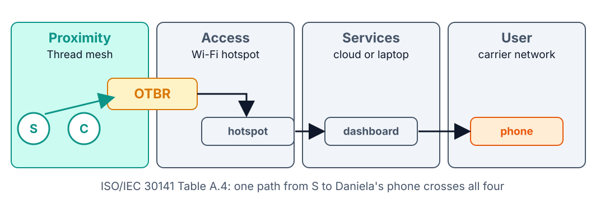
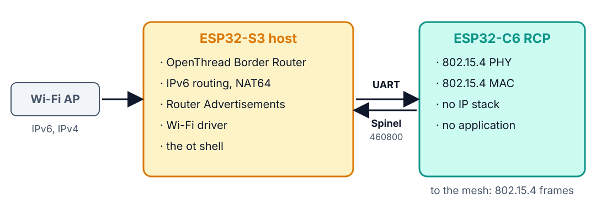
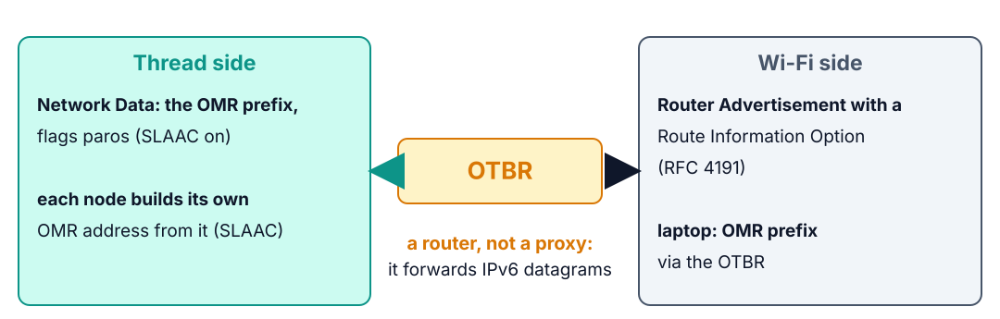
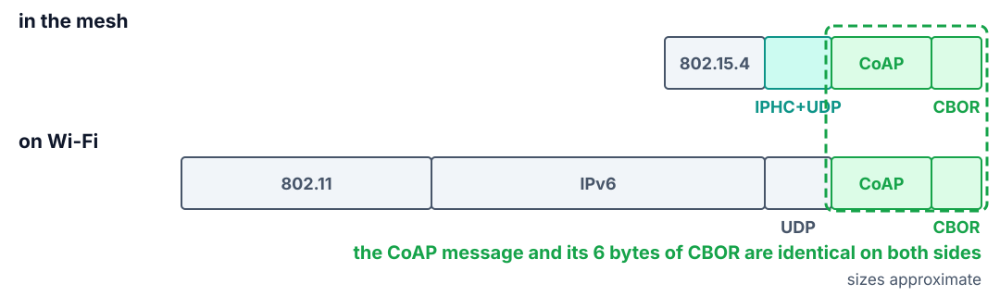

<!--
theme: course
paginate: true
title: The border router
style: |
  section { --course: #1d4ed8; }
-->

<!-- _class: lead -->
<!-- _paginate: false -->

# The border router

**Session 5** · where four networks meet, and what the field does without it

Daniela's phone can't see the field: the mesh is an island. How do we let the phone in?

<!--
0:00–1:30. Callback: Lab 3 made the valve obey reliably, Lab 4 made the node say when
its data is stale. Both contracts work inside the mesh. From the house, on her phone,
Daniela sees nothing. And Edwin's condition: if the new box dies, the valve must still
obey whoever is in the field.
-->

---

<!-- _class: agenda -->

## Today

1. **A new chart**: devices and networks
2. **Two boards, one router**: host and radio
3. **Two address mechanisms**: a routable prefix, NAT64
4. **Without the border router**: what survives
5. **Lab**: what you'll measure

By the end you can trace a packet from S to a phone, network by network.

<!--
1:30–2:30. Reading: theory_foundations.md §5. The lab firmware is Zephyr's OpenThread
Border Router sample, built for an ESP32-S3 with an ESP32-C6 as its radio.
-->

---

<!-- _class: s1 question -->
<!-- _header: 1 · A new chart -->

## How many networks lie between Daniela's phone and the soil sensor?

1. One: it's all IP
2. Two: Thread and the Internet
3. Four
4. It depends on the phone

<!--
2:30–4:30. Answer: C, by the standard's count: the Thread mesh, the OTBR's Wi-Fi, a
services network (cloud or a laptop), the carrier's. Each runs different protocols,
MTUs and addressing. A is the misconception the lab dismantles: IP end to end doesn't
mean one network. Then: where do they meet? One device. That's the lab.
-->

---

<!-- _class: s1 figure -->
<!-- _header: 1 · A new chart -->

## Four networks, and one device on the seam



<!--
4:30–8:00. Labs 1–4 climbed the Functional viewpoint's domain map: one device, the
application stack growing upward. Today spans several devices and four networks, and
the standard has charts made for it, as a pair: the enterprise system pattern (Table
A.3, Figure A.5) names the device, and the enterprise networking pattern (Table A.4,
Figure A.6) names the networks; A.4 says it "is using" A.3. Same standard, different
chart: domains weren't wrong, the question changed.
-->

---

<!-- _class: s1 -->
<!-- _header: 1 · A new chart -->

## The standard already describes this device

> *"IoT gateways are devices which connect SCD with other domains. IoT gateways provide functions such as protocol conversion, address mapping, data processing, information fusion, certification, and equipment management."*
> — ISO/IEC 30141:2024, Table A.3

<!--
8:00–10:00. Project it verbatim. Six functions; which does our OTBR do, and which not
yet? Don't fill it in: the scorecard with evidence is the DDR's §4, after the lab.
-->

---

<!-- _class: s1 question -->
<!-- _header: 1 · A new chart -->

## In the Functional viewpoint's domain map, where does the border router belong?

1. RAID: it lets the outside reach the system
2. SCD: the gateway connects SCD with other domains
3. ASD: it carries the application's traffic
4. OMD: it manages the network

<!--
10:00–12:00. Answer: B. Figure A.5 draws the IoT gateway inside the SCD, and Table A.3
says gateways "connect SCD with other domains". A is the common wrong answer: RAID
hosts access management and interchange, the authenticated exposure of capabilities
to outside consumers. It lights up in Labs 6–7, not today. Keep RAID gray on the board.
-->

---

<!-- _class: s2 figure -->
<!-- _header: 2 · Two boards, one router -->

## Two boards, one device



<!--
12:00–15:00. The S3 has Wi-Fi and no 802.15.4 radio; the C6 has the radio. The radio
co-processor (RCP) is dumb on purpose: no IP stack, no application, just frames over
Spinel on a UART. The host does everything else: 6LoWPAN, routing, NAT64, Router
Advertisements on Wi-Fi. From the mesh it is one Thread node; from the AP, one Wi-Fi
client. A Raspberry Pi running ot-br-posix with a USB RCP is the same architecture
with another host. Practical: the S3 needs PSRAM (N8R8 or N16R8), and the RCP must be
powered before the S3 or the S3 browns out through the UART.
-->

---

<!-- _class: s3 figure -->
<!-- _header: 3 · Two address mechanisms -->

## A prefix the outside can reach, announced on both sides



<!--
15:00–19:00. Once Wi-Fi is up, the OTBR publishes an off-mesh routable (OMR) prefix in
the Thread Network Data. With a home router that delegates a prefix it is global; a
phone hotspot delegates none, so the OTBR uses its own ULA (fd…). Every node builds an
address in it by SLAAC (RFC 4862). On Wi-Fi, the OTBR's Router Advertisements carry a
Route Information Option (RFC 4191), so laptops learn the route. Hook: the same idea
as a home router handing your laptop an IPv6 prefix, with an 802.15.4 radio on one
side. DDR question 1 asks why this is enough; let them get there.
-->

---

<!-- _class: s3 -->
<!-- _header: 3 · Two address mechanisms -->

## S gains one address

```
uart:~$ ot ipaddr
2800:484:9080:855e:a683:e5fc:fe92:bf6    OMR: the OTBR's prefix
fdd7:c9f8:19bb:c91:0:ff:fe00:a001        RLOC
fdd7:c9f8:19bb:c91:e176:7bb0:393c:7fb6   ML-EID
fe80:0:0:0:462:934e:69a:7f2f             link-local
```

The OTBR serves no resource of its own: it routes.

<!--
19:00–20:30. Real output from the course bench (home router, delegated prefix). Same
`/env/temp`, new path. The OTBR doesn't parse CoAP or terminate connections; a CoAP to
HTTP proxy on top would be a different device and a Lab 7 topic.
-->

---

<!-- _class: s3 -->
<!-- _header: 3 · Two address mechanisms -->

## NAT64: an IPv6-only node reaches the IPv4 Internet

```
uart:~$ ot ping 8.8.8.8
Pinging synthesized IPv6 address: fdab:819c:92ef:2:0:0:808:808
```

- The last 32 bits carry the IPv4 address: `808:808` is 8.8.8.8
- The /96 prefix is a route in the Network Data (RFC 6052)
- The OTBR swaps the IPv6 source for its own IPv4 and back (RFC 6146)

<!--
20:30–23:30. The IETF reserves 64:ff9b::/96; OpenThread uses its own ULA /96 unless
the network offers one. The NAT table maps (IPv6 source, port) to (IPv4 source, port),
like a home router's NAT plus a protocol conversion. Ask which hop they expect to
dominate the round trip; Task E measures it. Why NAT64 at all when Thread is IPv6 is
DDR question 2. Reverse direction, for the curious: an IPv4-only phone can't reach
an IPv6-only sensor without 464XLAT or a proxy.
-->

---

<!-- _class: s3 figure -->
<!-- _header: 3 · Two address mechanisms -->

## What grows at the boundary, and what doesn't



<!--
23:30–25:30. Inside the mesh, IPHC squeezes IPv6 and UDP into a few bytes; on Wi-Fi the
full 40-byte header comes back with the 802.11 header. The CoAP message and its 6 bytes
of CBOR cross unchanged. DDR question 3 asks why; leave it to them. Contrast for the
notes only: a custom binary protocol would need a translator here.
-->

---

<!-- _class: s4 question -->
<!-- _header: 4 · Without the border router -->

## The OTBR loses power. Which of these still works?

1. C opens S's valve from inside the mesh
2. Daniela's dashboard on her phone
3. S pings 8.8.8.8
4. Nothing: the mesh needs its router

<!--
25:30–28:00. Answer: A. C and S talk inside the proximity network; the OTBR was never
on that path. B and C both cross the OTBR. D confuses the border router with the
mesh's routers: the mesh routes itself (Lab 2). This is the local-first property, and
the reason Thread plus CoAP suits a farm: the valve doesn't wait for the cloud. Task F
measures it. Production answer: two OTBRs on the same mesh, each publishing its
routes; ADR-005 names the single OTBR as a pilot compromise.
-->

---

<!-- _class: s4 -->
<!-- _header: 4 · Without the border router -->

## Same role, other stacks

| Stack | Its gateway | Translates the application? |
|---|---|---|
| Thread | border router | no: it routes IPv6 |
| LoRaWAN | gateway + network server | yes: to HTTP or MQTT |
| BLE Mesh | phone or hub with a proxy | yes |
| Zigbee | coordinator + bridge | yes |

<!--
28:00–31:00. The choice cascades: pick LoRaWAN and your API is whatever the network
server exposes, not CoAP; pick BLE through a phone and the system stops when the phone
is in airplane mode. Matter rides on exactly this Thread border router. Hook: you
picked Thread in Lab 1 before you knew what a border router was; today you see what
you bought. LoRaWAN still wins on range.
-->

---

<!-- _class: takeaway -->

## The one thing to remember

> A border router publishes a prefix and forwards packets; the field must still work without it.

<!--
31:00–31:30. First line of today's DDR entry.
-->

---

<!-- _class: s5 -->
<!-- _header: 5 · Lab -->

## Today in the lab

| You measure | Predict now |
|---|---|
| Wi-Fi hop, power save on / off | ____ ms |
| Laptop → S, CoAP GET | ____ ms |
| Latency the OTBR adds | ____ ms |
| NAT64: S → 8.8.8.8 | ____ ms |
| OTBR off: C → S PUT | works? ____ |

Predictions are due before you power the boards.

<!--
31:30–38:00. Walk Tasks A–F. Hotspot on 2.4 GHz and WPA2: the S3 has no 5 GHz radio
and WPA3-only won't connect. The RCP is a third C6; plug it in before the S3.
`ot factoryreset` before `ot dataset set active` on S and C, or a node restores its
Lab 4 router role and founds its own partition. There is no web UI: the `ot` shell on
the S3's console has no authentication, so whoever holds the USB cable controls the
OTBR, a gap to flag in the DDR. Live demo if there's time: the dashboard on a phone
showing the same a16174f9… bytes C sees in the mesh.
-->

---

## References

- ISO/IEC 30141:2024 §A.4 (Table A.3, Figure A.5) and §A.5 (Table A.4, Figure A.6)
- RFC 4862 (SLAAC) · RFC 4191 (Route Information Option) · RFC 6052 and RFC 6146 (NAT64)
- [Zephyr's OpenThread Border Router sample](https://docs.zephyrproject.org/latest/samples/net/openthread/border_router/README.html)
- [Lab 5](../labs/lab5.md) · [SOP-05](../labs/sops/sop05_border_router.md)

<!--
38:00–40:00. Questions, then the lab.
-->
