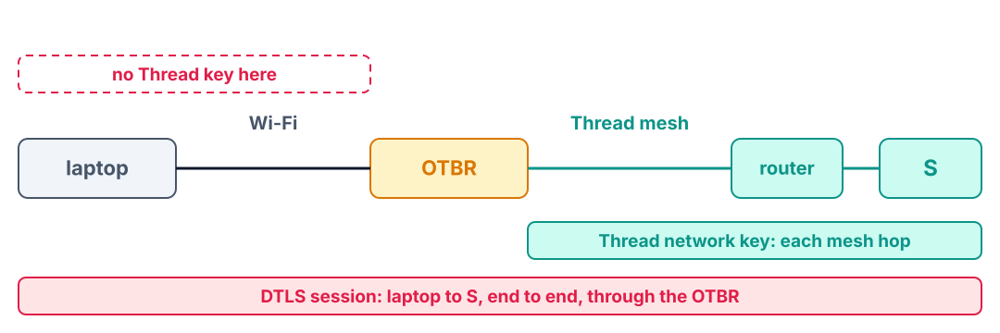
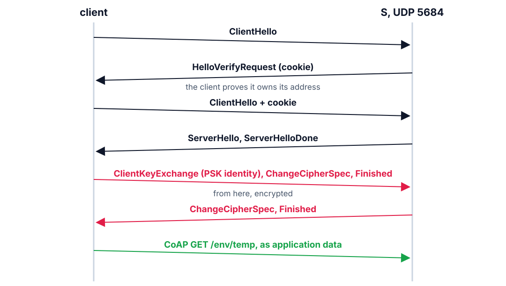

<!--
theme: course
paginate: true
title: A lock on the bytes
style: |
  section { --course: #1d4ed8; }
-->

<!-- _class: lead -->
<!-- _paginate: false -->

# A lock on the bytes

**Session 6** · DTLS, what it costs, and what it leaves open

Lab 5 let Daniela's phone in. Who else did it let in?

<!--
0:00–1:30. Read Edward's memo: guest Wi-Fi, a free CoAP app, every temperature read,
the valve opened. Lab 5's deliverables already flagged the open door; today it gets a
lock.
-->

---

<!-- _class: agenda -->

## Today

1. **The open door**: why the mesh key isn't enough
2. **DTLS**: the handshake and the record
3. **What the lock costs**: and the threats it answers
4. **Beyond the channel**: code and watching
5. **Lab**: what you'll measure

By the end you can trace a PSK handshake, say what each property of AES-CCM buys, and price a session.

<!--
1:30–2:30. Reading: RFC 6347 §4.2 for the handshake, RFC 7925 for the IoT profile.
-->

---

<!-- _class: s1 question -->
<!-- _header: 1 · The open door -->

## Thread already encrypts every frame with the network key. Does that stop Edward's OPEN from the guest Wi-Fi?

1. Yes: every frame on the mesh is encrypted
2. No: the OTBR routes his packet in, and the mesh encrypts it for him
3. Only if he is out of radio range
4. Yes: the network key authenticates the sender

<!--
2:30–5:00. Answer: B. The single most common misconception of the lab. The network
key protects the link, hop by hop, against outsiders on the radio. Edward's packet
enters through the OTBR as legitimate IPv6, and the mesh carries it like any other.
D confuses link-layer membership with application identity: any node on the mesh, or
anything the OTBR routes in, holds that "authentication".
-->

---

<!-- _class: s1 figure -->
<!-- _header: 1 · The open door -->

## Two locks, two scopes



<!--
5:00–8:00. The Thread key keeps strangers off the radio; it does nothing on the Wi-Fi
segment, and nothing against a mesh member. DTLS runs from the client application to
S's application, and the OTBR forwards its records without understanding them. Lens:
Trustworthiness (§6.6) is cross-cutting, an audit over every domain, not a new box. On
the Functional map, the PSK-gated endpoint realises RAID's access-management
component, gray since Lab 1. The /env/temp and /act/valve contracts don't change:
only how they are reached.
-->

---

<!-- _class: s2 -->
<!-- _header: 2 · DTLS -->

## TLS needs TCP; DTLS brings its own

| TLS leans on TCP for | DTLS does it itself |
|---|---|
| in-order handshake messages | sequence numbers and reassembly |
| resending lost handshake bytes | retransmits whole flights |
| a held-open connection | keeps a session (keys), not a socket |
| a stream nobody can replay | a per-record replay window |

<!--
8:00–10:00. CoAP runs on UDP (Lab 3). Why doesn't DTLS just use CoAP's CON to resend
the handshake? Layering: DTLS sits below CoAP and must secure the channel before CoAP
exists on it. Two reliability mechanisms at two layers.
-->

---

<!-- _class: s2 figure -->
<!-- _header: 2 · DTLS -->

## A PSK handshake, flight by flight



<!--
10:00–14:00. Walk it. The cookie exchange (flights 2–3) is anti-DoS: the server keeps
no state until the client echoes a cookie sent to its address. No certificates on the
wire: the client sends only a PSK identity; both sides already hold the key and prove
it with the Finished messages, which are the first encrypted records. After the last
flight every CoAP exchange reuses the session. The lab tool prints these flights with
their times (`-v`): don't give numbers now, they are a prediction.
-->

---

<!-- _class: s2 -->
<!-- _header: 2 · DTLS -->

## Reading the suite's name

```
TLS_PSK_WITH_AES_128_CCM_8
    PSK          keys from a pre-shared secret
    AES_128      the block cipher, a 128-bit key
    CCM          counter mode + CBC-MAC: authenticated encryption
    8            an 8-byte authentication tag
```

One operation gives **confidentiality** and **integrity**.

<!--
14:00–16:00. AEAD: authenticated encryption with associated data. The counter mode
hides the CBOR; the tag, keyed by the session, fails if one bit changes or if someone
without the key forges a record, and the record is dropped before CoAP sees it. Why 8
bytes and not 16: air time on a 250 kbps radio; RFC 7925 recommends it. Hook:
encryption stops Edward reading, authentication stops him opening the valve; DDR
question 3 asks which one is the safety case.
-->

---

<!-- _class: s2 question -->
<!-- _header: 2 · DTLS -->

## Edward can't decrypt yesterday's OPEN record, so he resends it verbatim today. What happens?

1. The valve opens: it is a valid record
2. It is dropped: its sequence number is outside the replay window
3. It is dropped: the key changed overnight
4. S reboots

<!--
16:00–18:30. Answer: B, if the session is the same; a new session has new keys, so the
old record wouldn't even decrypt. Both are protocol features a hand-rolled "AES the
payload" scheme lacks: without a sequence number the replay lands and the valve
opens. C assumes rotation that nobody configured. This is why you use DTLS instead
of inventing a scheme.
-->

---

<!-- _class: s3 -->
<!-- _header: 3 · What the lock costs -->

## Pay the handshake once, not per reading

- A handshake is several round trips of radio time before the first byte of data
- Per reading, an open session adds only a small record header and tag
- So the engineering is **how long a session lives**: the same question as Lab 3's poll period

<!--
18:30–21:00. Wrong: handshake per reading, and the battery math from Lab 3 collapses.
Right: one session carries many readings. On a sleepy valve every handshake flight
waits for a poll, so a handshake can take seconds; keep the session alive (Connection
ID, resumption) or accept the latency for rare commands. A session is also memory on S:
it can hold only a few at once, and Task F finds the number. Students price it in Task C
with their own numbers.
-->

---

<!-- _class: s3 -->
<!-- _header: 3 · What the lock costs -->

## STRIDE for the guest-Wi-Fi attacker

| Threat | In SoilSense | Control |
|---|---|---|
| **S**poofing | sends as if it were a client | PSK: no key, no session |
| **T**ampering | forges the OPEN | AEAD tag |
| **R**epudiation | who sent that command? | a gap with a shared key |
| **I**nformation disclosure | reads `/env/temp` | AES-CCM |
| **D**enial of service | floods handshakes | the cookie, and… |

<!--
21:00–24:00. Task A asks for this table before any code, so build it with the room and
leave the last row open: what else limits a flood, and what does it cost honest
clients? (Task F.) Repudiation is honest: a shared key can't say which holder sent a
command. At fleet scale the shared PSK is the single point of compromise: one stolen
node, every node forgeable.
-->

---

<!-- _class: s3 -->
<!-- _header: 3 · What the lock costs -->

## PSK now; certificates when the fleet grows

| | PSK | Certificates |
|---|---|---|
| On the device | a key and an identity | X.509 parser, chain, CA store |
| Handshake | cheapest | signatures to compute |
| Identity | one for every holder | one per device |
| One node stolen | re-key everyone | revoke one certificate |
| Needs a PKI | no | yes |

<!--
24:00–27:00. ADR-006 picks PSK for a five-node pilot and names the condition that
forces certificates: revocation. Key lifecycle: provision, rotate, detect, revoke. The
lab hardcodes the key in flash; production puts a per-device key in a secure element
at manufacture. Ask: 200 nodes, one PSK, a node found in a competitor's lab: what do
you do this afternoon? Re-key all 200. How? That leads to the next slide.
-->

---

<!-- _class: s4 -->
<!-- _header: 4 · Beyond the channel -->

## DTLS is one of three locks

| Secures | Mechanism | In the course |
|---|---|---|
| the **channel**: data in flight | DTLS with a PSK | today |
| the **code**: what runs on the node | signed updates (MCUboot) | Lab 8 |
| the **system over time**: is anything wrong? | telemetry, baselines, alerts | Lab 7 |

<!--
27:00–31:00. DTLS does nothing if the firmware itself is bad or stale. Signed updates
are authentication for code, the tag's logic moved to the boot path; unsigned OTA is a
remote-code-execution channel. And neither prevents a node dying or an attack in
progress from going unnoticed: a failed-handshake rate is a security signal on the
same dashboard as a battery trend. The §9 audit's gaps column should name both.
-->

---

<!-- _class: takeaway -->

## The one thing to remember

> Encryption keeps Edward from reading the soil; authentication keeps him from opening the valve.

<!--
31:00–31:30. First line of today's DDR entry.
-->

---

<!-- _class: s5 -->
<!-- _header: 5 · Lab -->

## Today in the lab

| You measure | Predict now |
|---|---|
| Plain CoAP to S: answered? | ____ |
| Wrong key: answered? | ____ |
| Handshake, C → S in the mesh | ____ ms |
| Handshake, laptop → S through the OTBR | ____ ms |
| Bytes DTLS adds per message | ____ B |

Predictions are due before you flash.

<!--
31:30–38:00. Walk Tasks A–F. Pick your own key: every pair shares the build's default
otherwise, and could command each other's valves. Same key on S, C and the laptop. Port
5684, not 5683. A wrong key produces silence, not an error message: that is DDR
question 4. The laptop tools need `source ~/zephyrproject/env.sh` (the cryptography
package lives there). Capturing the Wi-Fi needs Wireshark or tcpdump on your laptop.
-->

---

## References

- RFC 6347 (DTLS 1.2) §4.2 · RFC 6655 (AES-CCM in TLS) · RFC 4279 (PSK) · RFC 7925 (IoT profile)
- ISO/IEC 30141:2024 §6.6 (Trustworthiness), Figure A.5 (RAID)
- [Lab 6](../labs/lab6.md) · [SOP-06](../labs/sops/sop06_security.md)

<!--
38:00–40:00. Questions, then the lab.
-->
