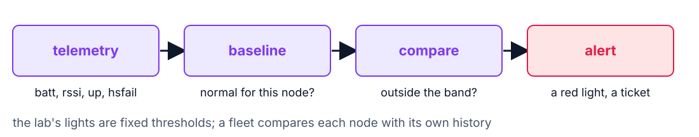
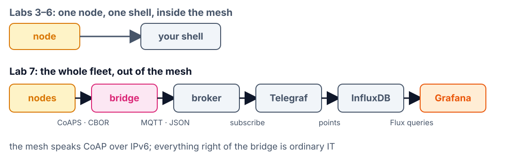
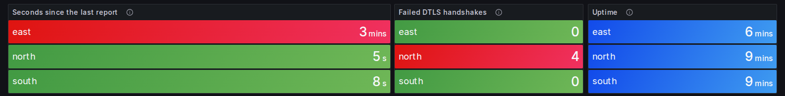

<!--
theme: course
paginate: true
title: The fleet on one screen
style: |
  section { --course: #1d4ed8; }
-->

<!-- _class: lead -->
<!-- _paginate: false -->

# The fleet on one screen

**Session 7** · telemetry, the bridge out of the mesh, and a dashboard operations can run

Node 4 went dark overnight. How would Edwin have known before a crop did?

<!--
0:00–1:30. Read Edwin's memo. Lab 6 locked the channel and named two gaps it leaves:
noticing a dead node or an attack, and acting on it. Today closes the first: the fleet
reports its own health, and the reports leave the mesh for a real dashboard.
-->

---

<!-- _class: agenda -->

## Today

1. **Watching**: what telemetry is for
2. **Signals**: what each one tells, and the detection loop
3. **Out of the mesh**: the bridge and the broker
4. **The dashboard**: red before a node dies
5. **Lab**: what you'll measure

By the end you can design a health report, place the bridge in ISO/IEC 30141, and time a silent node.

<!--
1:30–2:30. Reading: ISO/IEC 30141 §6.4 (the Usage viewpoint, Table 4) and Figure A.5 for
OMD and RAID.
-->

---

<!-- _class: s1 question -->
<!-- _header: 1 · Watching -->

## Node 4 stops overnight. With the Lab 6 firmware, when does Edwin find out?

1. At once: DTLS reports the lost session
2. When someone next asks it for a reading, or a crop dies
3. When the OTBR notices the node is gone
4. At the next leader election

<!--
2:30–5:00. Answer: B. Nothing in Labs 1–6 reports a node's own state to anyone. A: DTLS
sessions just expire on the server side. C and D: the mesh does notice, and heals
around the node, but tells no human. The smallest thing that would have warned him: a
battery trend and a regular report: telemetry.
-->

---

<!-- _class: s1 -->
<!-- _header: 1 · Watching -->

## Business data and telemetry: two audiences, one node

| | Business data | Telemetry |
|---|---|---|
| Example | soil at 24.5 °C | battery 3100 mV |
| For | Daniela | Edwin, Gustavo |
| Asks | is my soil OK? | is the node OK? |
| Changes | in minutes | over hours |

<!--
5:00–8:00. Streaming telemetry at the reading's rate is the classic mistake: twice the
air time for data nobody reads second by second. The engineering, again, is how often
you pay. On the ISO map, the health report is an OMD capability (Operation & Management
Domain); the Usage viewpoint (§6.4) reads it through roles and lifecycle: who watches,
what happens between red and a battery swap. A box and an overlay: don't merge them.
-->

---

<!-- _class: s2 -->
<!-- _header: 2 · Signals -->

## What each signal tells an operator

| Signal | Normal | Changes when |
|---|---|---|
| battery | slow decline | a fault; dying soon |
| link RSSI | stable | moved, blocked, jammed |
| uptime | always grows | it rebooted |
| failed handshakes | zero | wrong key, or key guessing |
| silence | regular reports | any of these, or theft |

<!--
8:00–11:00. Two are security signals, three are health signals, and that is the point:
on a fleet, security and reliability are watched on the same screen. Edwin watching
batteries and Edward watching for an attack read one stream through different
thresholds. Failed handshakes come from the node itself: the firmware counts them by
wrapping Mbed TLS's handshake, the Lab 5 technique again.
-->

---

<!-- _class: s2 figure -->
<!-- _header: 2 · Signals -->

## Noticing is a loop, not a feature

<!--
11:00–13:00. Telemetry, a notion of normal, a comparison, an alert. A fixed threshold
catches the obvious; most fleet anomalies are relative: a node that read −60 dBm for a
month and reads −80 today is failing, although −80 is "fine". Compare a node with its
own history and with its neighbours in the same field.
-->

---

<!-- _class: s2 question -->
<!-- _header: 2 · Signals -->

## A node read −60 dBm for a month. Today it reads −80 dBm. The alarm is at −90 dBm. Is it fine?

1. Yes: it is above the alarm
2. No: against its own baseline, it is degrading
3. No: −80 dBm can't carry Thread
4. Only if its battery is fine

<!--
13:00–15:00. Answer: B. A treats the threshold as the definition of healthy. C is false:
Lab 1 measured working links well below −80. D mixes two independent signals. The lab
builds fixed thresholds; the baseline is what production adds on top.
-->

---

<!-- _class: s3 figure -->
<!-- _header: 3 · Out of the mesh -->

## The data leaves the mesh through one component

<!--
15:00–19:00. The bridge terminates the mesh protocol on one side and speaks a broker
protocol on the other: it holds a DTLS session per node, observes /env/temp and
/sys/health, decodes CBOR and publishes JSON. That is RAID's interchange subsystem,
the half Lab 6 left gray, and Table A.3's information fusion that Lab 5's scorecard
deferred. Caution: the OTBR is not the bridge. The OTBR routes opaque IPv6; the bridge
parses and re-encodes.
-->

---

<!-- _class: s3 -->
<!-- _header: 3 · Out of the mesh -->

## Why a broker, and not every phone to every node

| Each consumer to each node | A broker in between |
|---|---|
| N consumers × M nodes sessions | one bridge session per node |
| an IPv4 phone can't reach an IPv6 node | anything with TCP reaches the broker |
| a battery node answers everyone | the node reports once, the broker fans out |
| every consumer knows every address | consumers know a topic |

<!--
19:00–22:00. Callback to session 5: an IPv4-only phone needs 464XLAT or a proxy to reach
the mesh, so the industry puts a broker on the access side. Lab 6 adds one more row: a
node holds only a few DTLS sessions. DDR question 2.
-->

---

<!-- _class: s3 -->
<!-- _header: 3 · Out of the mesh -->

## The bridge is the architecture; the broker is a setting

- Mosquitto on your laptop, AWS IoT Core, HiveMQ, ThingsBoard: all speak MQTT, none speaks CoAP over a Thread mesh
- So every one of them needs the same bridge
- Moving to a cloud broker changes the host, the port and three certificate files

<!--
22:00–25:00. A vendor's "connect your device in one click" hides a bridge like this
one. The lab stack (Mosquitto, Telegraf, InfluxDB, Grafana) is what many operations
teams run themselves; a cloud broker is the optional Task E. Puzzle, no answer: the
mesh is local-first, but visibility now depends on the bridge. Did you just add a
single point of failure, and for what?
-->

---

<!-- _class: s4 figure -->
<!-- _header: 4 · The dashboard -->

## Red before a node dies

The course bench during the drills: one node off the network, one probed with a wrong key.

<!--
25:00–29:00. The course bench during the Lab 7 drills, three ESP32-C6 nodes: east taken
off the network (red after 150 s of silence), north probed once with a wrong key (one
probe counted four times, as the client retried its last flight). The full dashboard also
has the temperature, battery and RSSI series and a fleet table: open it live if you can.
Walk each panel: which question it answers, for whom. The silence light is a heartbeat detector:
a node that reports every period and hasn't for 150 s is red. Students time their own
drills; don't quote these.
-->

---

<!-- _class: s4 -->
<!-- _header: 4 · The dashboard -->

## Watching is not acting

- The dashboard tells Edwin which node to visit
- It can't fix a node, or update 200 of them
- Lab 8: the fleet must recover by itself, and updates must be signed

<!--
29:00–31:00. Pillar 3 (watching the system over time) now exists. Pillar 2 (signed code)
is Lab 8's stretch: the same path the telemetry comes up is how an update would go
down. And Samuel's chaos script: the dashboard is how you'll prove recovery happened
without anyone touching a board.
-->

---

<!-- _class: takeaway -->

## The one thing to remember

> Every node reports its own health, and silence is a signal too.

<!--
31:00–31:30. First line of today's DDR entry.
-->

---

<!-- _class: s5 -->
<!-- _header: 5 · Lab -->

## Today in the lab

| You measure | Predict now |
|---|---|
| Bytes of one health report | ____ B |
| Your report period | ____ s |
| Radio-on per day for health, one node | ____ s |
| Silent node → red | ____ s |
| Wrong-key probe → red | ____ s |

Predictions are due before you start the stack.

<!--
31:30–38:00. Teams of four: two pairs, one fleet, one key. Pull the Docker images at
home (setup §7): about 1 GB. The Lab 0 broker holds port 1883: stop it, or move the
stack's broker. Name the nodes on the bridge's command line; the dashboard shows those
names. A failed handshake is counted when the node gives up, so that light lags the
probe: time it anyway.
-->

---

## References

- ISO/IEC 30141:2024 §6.4 (Usage), Figure A.5 (OMD, RAID), Table A.3
- [MQTT 3.1.1](https://docs.oasis-open.org/mqtt/mqtt/v3.1.1/mqtt-v3.1.1.html) · RFC 7641 (Observe)
- [Grafana](https://grafana.com/docs/grafana/latest/) · [InfluxDB 2](https://docs.influxdata.com/influxdb/v2/) · [Telegraf](https://docs.influxdata.com/telegraf/v1/)
- [Lab 7](../labs/lab7.md) · [SOP-07](../labs/sops/sop07_fleet.md)

<!--
38:00–40:00. Questions, then the lab.
-->
